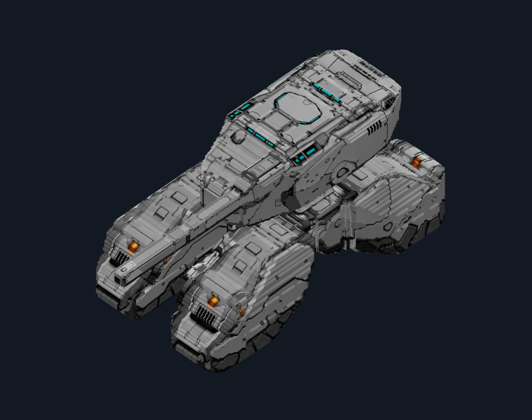

# stack3.js

Turn four or six orthographic views into a **3D mesh** or a **runtime sprite stack**. Open a finished example, inspect the reconstruction stages, or convert your own atlas from the CLI.



## Quick start

### 1. Install the CLI

Install **Node.js 22.12 or later**, then run the command below. [CLI releases](https://github.com/ev3rlit/stack3.js/releases)

```sh
npm install -g https://github.com/ev3rlit/stack3.js/releases/latest/download/stack3-cli.tgz
stack3 --version
```

### 2. Install the Codex skill

Paste this into Codex, then invoke `$stack3` to prepare atlases, convert assets, or work on a scene. [Codex skill installation](skills/stack3/README.md#install-in-codex)

```text
$skill-installer Install the stack3 skill from https://github.com/ev3rlit/stack3.js/tree/main/skills/stack3
```

### 3. Open Future Tank

Run these commands in any working directory. The installed CLI copies the bundled example and opens Playground.

```sh
stack3 example future-tank
stack3 project open future-tank.stack3.json --playground
```

- Press **Play** and use **A/D** to turn the chassis or **Q/E** to turn the turret and barrel.
- Open **4-view comparison** to see the reconstruction gallery. Try **Layers** for resolution, **Spacing** for the gap between sprite slices, and **Explode** for part separation.
- Use the public viewer to try **Traffic Cone** or load your own PNG in the browser. [Open the web viewer](https://ev3rlit.github.io/stack3.js/)

[Future Tank images and controls](samples/future-tank/README.md) · [All sample atlases](samples/README.md)

## Workflow


1. **Prepare the atlas.** Arrange four orthographic silhouettes as **TOP, LEFT, FRONT, REAR**. Match the scale and ground line, and leave gaps between silhouettes. Point the front down in TOP and left in LEFT. For six views, add **RIGHT** and **BOTTOM**.
2. **Reconstruct.** The viewer and CLI carve a volume from the silhouettes. Give independently moving objects their own atlas so each part keeps its own shape, texture, and pivot.
3. **Preview and export.** Use **Sprite stack** for horizontal slices or **3D mesh** for a textured GLB. For an assembled object, embed the source PNGs and position the parts in a scene project.

[Input preparation guide](skills/stack3/references/orthographic-views.md) · [Scene project commands](apps/cli/README.md#scene-projects)

## Convert an atlas

```sh
stack3 example traffic-cone
stack3 inspect traffic-cone-4view.png --layout top,left,front,rear
stack3 build traffic-cone-4view.png --layout top,left,front,rear --output cone.glb
stack3 build traffic-cone-4view.png --layout top,left,front,rear --format stack --output cone-stack/
stack3 view cone-stack/
```

A stack bundle contains `stack.png` and `stack.json`. For separate source images, pass a [view manifest](apps/cli/README.md) instead of an atlas layout.

## Releases

CLI and web releases are triggered separately. Push a tag on the commit you want to ship.

| Tag | Deployment |
| --- | --- |
| `cli-vX.Y.Z` | Build and smoke-test the npm tarball, then publish it to GitHub Releases |
| `web-vX.Y.Z` | Build the static viewer and deploy it to GitHub Pages |

```sh
git tag cli-v0.1.1
git push origin cli-v0.1.1
```

```sh
git tag web-v0.1.1
git push origin web-v0.1.1
```

[CLI workflow](.github/workflows/release-cli.yml) · [Web workflow](.github/workflows/deploy-web.yml)

## Development

```sh
git clone https://github.com/ev3rlit/stack3.js.git
cd stack3.js
npm ci
npm test
npm run build
npm run viewer
```

| Path | Contents |
| --- | --- |
| [`apps/viewer`](apps/viewer/README.md) | Asset viewer, scene editor, Playground, and reconstruction comparison |
| [`apps/cli`](apps/cli/README.md) | Inspect, build, export, and scene project commands |
| [`packages/core`](packages/core/README.md) · [`packages/three`](packages/three/README.md) | Reconstruction and Three.js rendering |
| [`samples`](samples/README.md) · [`skills/stack3`](skills/stack3/README.md) | Example images, scenes, and agent workflows |

[Feature plan](docs/README.md) · [Original Sprite Stacking skill](https://github.com/danielwh2/sprite-stacking) · [Sprite Stacking Demo](https://github.com/ev3rlit/sprite-stacking-demo)
