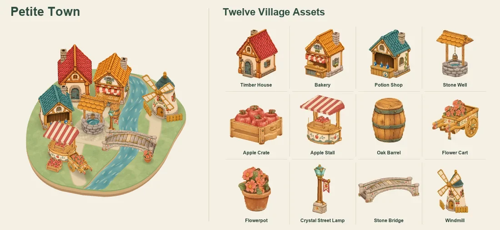
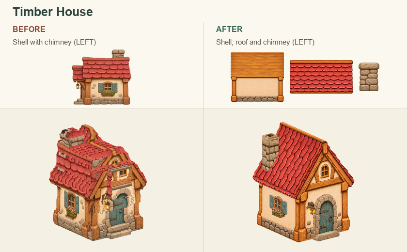
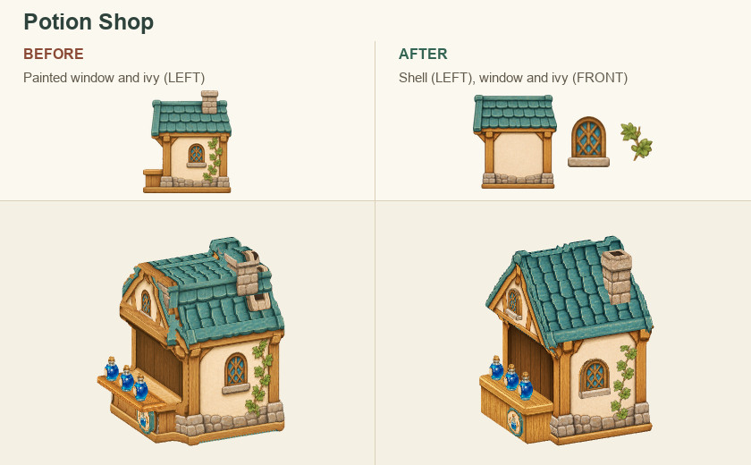
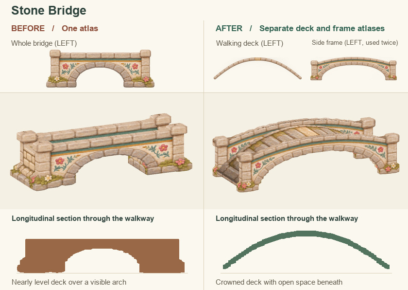
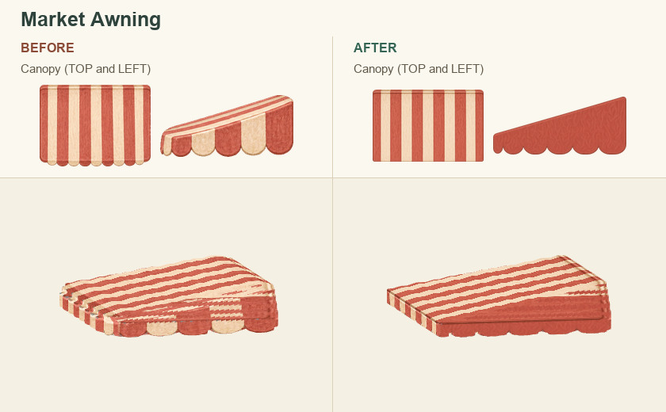
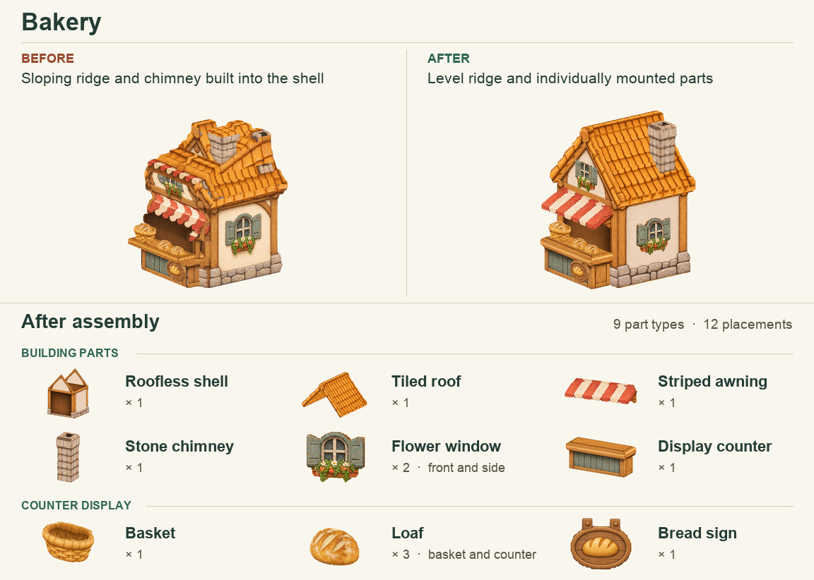
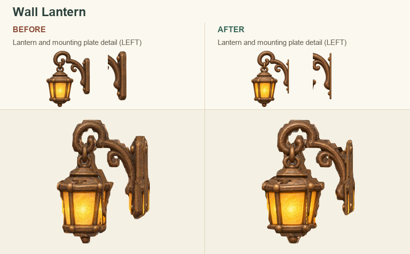
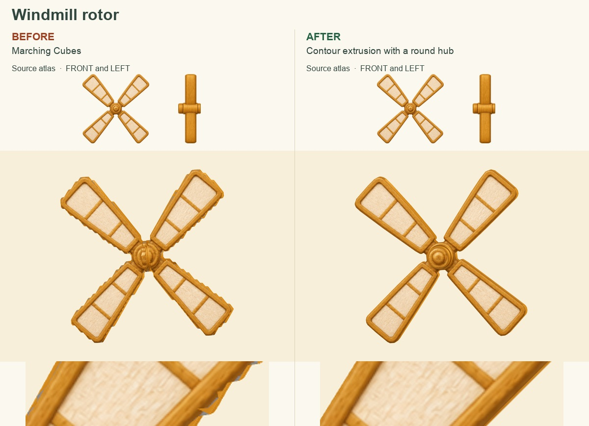
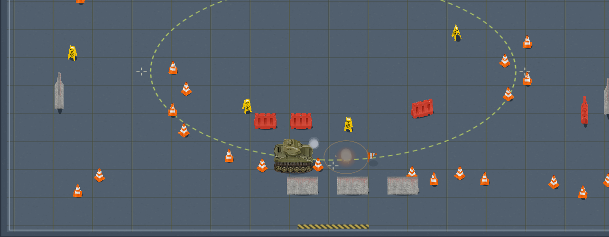
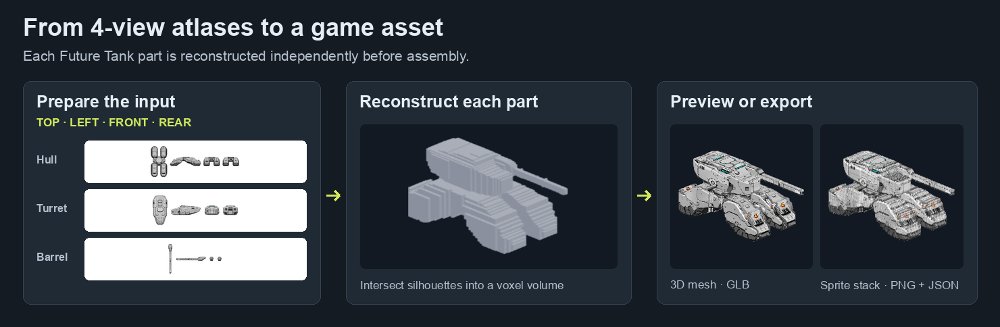

# stack3.js

The inspiration for stack3.js came from Daniel White’s **sprite-stacking** skill. It carves an object’s shape from four pixel-art views and cuts it into horizontal slices. Drawing those slices from the ground up produces a sprite that can rotate on screen. [Daniel White’s original skill and slicing tools](https://github.com/danielwh2/sprite-stacking)

We explored that idea in the Sprite Stacking Demo and built stack3.js to make the workflow reusable in other browser games. A PNG atlas with four or six views can become a **runtime sprite stack** or a **textured 3D mesh**. The house below uses a separate four-view atlas for each part. [Sprite Stacking Demo](https://github.com/ev3rlit/sprite-stacking-demo)

## How it works

[](examples/petite-town/atlases/)

### Atlas tips

- **First build** — Reference image → four-view atlas → mesh → 360° inspection
- **Texture distortion** — Camera angle, scale and alignment across TOP, LEFT, FRONT and REAR
- **Missing shape detail** — Separate atlases for the affected parts → individual meshes → assembly
- **Stepped edges on flat parts** — Contour Extrusion instead of Marching Cubes for blades, fins and signs

## Petite Town

A timber house, two shops and a market surround a stone well. Across the stream, a footbridge leads to a windmill. Each of the twelve village assets starts as one or more four-view atlases. The camera stays still as the windmill turns, the well ripples, and the stream flows beneath the bridge. On the right, each asset turns slowly so you can follow its painted details around the mesh.



[Full-size animated village view](docs/media/petite-town/village-view.webp) · [Full-size 12-asset turntable](docs/media/petite-town/assets-360.webp) · [Regenerate the showcase](examples/petite-town/README.md#readme-쇼케이스-재생성) · [Atlas and mesh comparisons](#atlas-and-mesh-comparisons)

### Play in your browser

[Play Petite Town](https://ev3rlit.github.io/stack3.js/examples/petite-town/standalone/)

Drag to orbit, scroll or pinch to zoom, and click a part to edit its layer count.

## Quick start

### 1. Install the CLI

Install **Node.js 22.12 or later**, then run the command below. [CLI releases](https://github.com/ev3rlit/stack3.js/releases)

```sh
npm install -g https://github.com/ev3rlit/stack3.js/releases/latest/download/stack3-cli.tgz
stack3 --version
```

### 2. Install the Codex skill

From your project directory, install the stack3 skill for Codex with the skills.sh CLI (Node.js 22.20 or later).

```sh
npx skills add ev3rlit/stack3.js --skill stack3 --agent codex
```

Invoke `$stack3` in Codex to prepare atlases, convert assets, or assemble a scene. [Skill guide](skills/stack3/README.md#install-in-codex) · [skills.sh CLI reference](https://skills.sh/docs/cli)

For a browser-only introduction, open Traffic Cone in the [public viewer](https://ev3rlit.github.io/stack3.js/) or load your own atlas. The [Future Tank sample](samples/future-tank/README.md) covers tracked motion and turret controls.

## Usage

In Codex, invoke `$stack3` with a request like one of these.

### Generate multi-view images

```text
$stack3 Create four orthographic views of the attached flower cart in TOP, LEFT, FRONT, REAR order. Make separate PNG atlases for the cart body and a wheel.
```

### Test in Playground

```text
$stack3 Import the flower cart atlases into a temporary scene, assemble the cart, and open it in Playground so I can check the wheel positions and rotation.
```

### Export assets

```text
$stack3 Export the cart body as cart-body.glb and the wheel as a sprite stack in wheel-stack/.
```

[Full stack3 skill workflow](skills/stack3/SKILL.md)

## Atlas and mesh comparisons

In each comparison, the **top row** shows the atlas panels involved in the change. The **bottom row** shows the archived and revised GLBs rendered from the same angle at the same scale. Select an image to rotate both versions together. To reproduce a repair, open this repository in Codex and paste the prompt below that comparison. Each prompt condenses the steps used for that asset.

### Timber house

The early LEFT view shows a convincing roof and chimney. From a diagonal angle, a second roofline appears around the chimney and above the door. Giving the roof and chimney their own silhouettes allowed the shingles to run continuously from ridge to eave. The door, lantern and windows mount separately on the shell.

[](docs/media/petite-town/house-360.webp)

[Rotate both houses](docs/media/petite-town/house-360.webp) · [Roof atlas](examples/petite-town/atlases/house-roof.png) · [Chimney atlas](examples/petite-town/atlases/house-chimney.png) · [Door atlas](examples/petite-town/atlases/house-door.png) · [Window atlas](examples/petite-town/atlases/house-window.png) · [Flower window atlas](examples/petite-town/atlases/house-window-flowers.png)

```text
$stack3 Rebuild the timber house from examples/petite-town/originals/house.png.
Give the shell, roof and chimney separate TOP, LEFT, FRONT and REAR atlases.
Keep the attic window on the gable. Mount the door and lantern at the entrance,
the flower window on the left wall and the plain window on the right.
Keep the red shingles and painted timber. Export the parts as GLBs and orbit
the assembly to check for one continuous roofline and an open chimney mouth.
```

### Potion shop

The window and climbing ivy read clearly in the original wall painting, but neither stood out from the plaster as the camera turned. We kept the painted detail, made a bare wall atlas, and mounted the window separately. Two leaves and their stem from the original LEFT view became a shallow relief mesh, repeated four times up the wall.

[](docs/media/petite-town/potionist-360.webp)

[Rotate both shops](docs/media/petite-town/potionist-360.webp) · [Window atlas](examples/petite-town/atlases/potion-window.png) · [Ivy atlas](examples/petite-town/atlases/potion-ivy.png)

```text
$stack3 Use examples/petite-town/originals/potion-shell.png as the reference.
Separate the chimney, counter, window and ivy from the plaster shell.
Use the painted window and a two-leaf sprig from the original LEFT view.
Give each its own four-view atlas and a shallow relief profile. Repeat the
sprig four times up the side wall and set the bottles on the counter.
Rebuild the shop and check from a grazing angle that the window and leaves
stand proud of the wall and their painted details appear only once.
```

### Stone bridge

The bridge needs a crowned walkway with open space beneath it. In the whole-bridge atlas, TOP shows the paving and LEFT shows the arch cut into the outer frame. The frame hides the deck in that side view. A single visual hull can reproduce the visible opening, but those silhouettes do not tell it where the deck rises or how much stone lies beneath the paving. The centerline section below shows the nearly level walking surface that results.

Give the **walking deck** and **side frame** separate atlases. With the frame removed, LEFT shows both edges of the thin, curved deck. Reconstruct that slab once, then place an instance of the frame on either side to form the arch and piers. In the assembled mesh, the crowned deck meets the banks at both ends and rises to 0.28 m above grade. The frame has a level rail between square-capped posts 0.66 m high. The longer frames have wider abutments and a narrower opening under the walkway. The capstones sample TOP while the decorated side walls retain their elevation textures.

[](docs/media/petite-town/bridge-360.webp)

[Rotate both bridges](docs/media/petite-town/bridge-360.webp) · [Whole-bridge atlas](examples/petite-town/atlases/bridge.png) · [Deck atlas](examples/petite-town/atlases/bridge-arch.png) · [Side frame atlas](examples/petite-town/atlases/bridge-side-frame.png) · [Assembled geometry checks](examples/petite-town/verification/geometry.json)

```text
$stack3 Use examples/petite-town/atlases/bridge.png as the whole-bridge reference.
Build two four-view atlases: one for the thin, crowned walking deck and one
for a side frame with the arch and piers. Use the narrow entrance as FRONT
and the long span as LEFT. Keep the capstone course level between square end posts. Show both
edges of the gently crowned deck in LEFT and keep the opening beneath it.
Seat both deck ends at bank level and mount one frame on each side. Map
the capstones from TOP and the decorated walls from their elevations. Check a
lengthwise section for a raised center and sight through the opening from
both sides to make sure the deck clears the arch.
```

### Market awning

TOP showed the hanging scallops, and LEFT showed a strip of the canopy's upper surface. Correcting the cameras gave TOP a straight front hem and LEFT a single sloping upper edge. We then followed one stripe from back to front. Only the outermost red stripe reaches the side, so the side curtain should be solid red all the way along its scalloped hem.

[](docs/media/petite-town/awning-360.webp)

[Rotate both awnings](docs/media/petite-town/awning-360.webp) · [Awning atlas](examples/petite-town/atlases/awning.png)

```text
$stack3 Correct TOP and LEFT in examples/petite-town/originals/awning.png.
In TOP, end every stripe at the same straight front hem. The hanging scallops
are hidden below it. In LEFT, put the low front tip on screen-left and draw
the roof edge as a single rising line. Keep the scalloped side curtain solid
strawberry red: the stripes run front to back, with red along the outer edge.
Keep FRONT and REAR intact. Rebuild the canopy and inspect it from above
and from the side.
```

### Bakery

The original side elevation sloped from back to front. Reconstructing it folded the shingles around the chimney. The rebuilt bakery has a roofless shell, a tiled roof with a level ridge, and a red-and-cream striped awning mounted above the counter. Eleven samples along each roof line measured 2.55 m at the ridge and about 1.62 m at the eave. [Roof and contact measurements](examples/petite-town/verification/bakery-assembly.json)

[](docs/media/petite-town/bakery-360.webp)

The two windows share one atlas. One faces the street above the awning, and the other sits on the side wall. The three loaves share another atlas. One sits in the basket and two rest directly on the counter.

[Rotate both bakeries](docs/media/petite-town/bakery-360.webp) · [Roofless shell](examples/petite-town/atlases/bakery-shell.png) · [Tiled roof](examples/petite-town/atlases/bakery-roof.png) · [Striped awning](examples/petite-town/atlases/bakery-awning.png) · [Assembly layout](examples/petite-town/src/assemblies.ts)

```text
$stack3 Rebuild the bakery from examples/petite-town/originals/bakery-shell.png.
Separate the roof, striped awning, chimney, flower window and counter from
the shell. Keep the ridge and eave horizontal along the full side elevation.
Mount the chimney on the roof, the awning over the counter and the windows
on the front and side walls. Put one loaf in the basket and two on the
counter, then check the assembly through a full turn.
```

### Wall lantern

In LEFT, the mounting plate showed part of its broad face and the rivets looked round. Regenerating just LEFT reduced the plate to a thin vertical edge with two rivet heads projecting in profile. TOP, FRONT and REAR remained pixel-identical.

[](docs/media/petite-town/lantern-360.webp)

[Rotate both lanterns](docs/media/petite-town/lantern-360.webp) · [Lantern atlas](examples/petite-town/atlases/house-lantern.png)

```text
$stack3 Replace only LEFT in examples/petite-town/originals/house-lantern.png.
Use TOP, FRONT and REAR as references. Look straight across the lantern's
width: the wall plate at screen-right should be a thin vertical edge, with
two rivet heads just breaking its outline in profile. Preserve the curled
bracket, amber glass and painted bronze. Rebuild the GLB, inspect the
plate side-on, and verify the other three panels are pixel-identical.
```

### Diagnose a reconstruction

Build the requested object, orbit it at the intended viewing scale, and save the angle that exposes the defect. Use that same angle to check the repair.

| Symptom | What to check | Example repair |
| --- | --- | --- |
| A surface leans or appears twice | Trace the same edge through TOP, LEFT, FRONT and REAR. Check panel assignment and camera alignment. | Regenerate the bakery's LEFT view to level the ridge. |
| A marking crosses onto the wrong face | Follow a stripe or seam through adjacent views. If the drawings agree, inspect face selection and UVs. | Correct the awning's side color while retaining the stripes on top. |
| Relief flattens when the camera turns | Identify which part hides the contour needed to recover the depth. | Separate the bridge deck from the frames that hide its profile, or the potion shop's window and ivy from the wall. |
| Parts look plausible alone but obstruct an opening or float when assembled | Overlay their silhouettes at scene scale and check their contact surfaces. | Check clearance through the assembled bridge and seat the bakery loaves on their support surfaces. |

### Windmill rotor

The two renders use the same atlas, scale and camera. In the Marching Cubes mesh, the long diagonal oak rails follow the sampling grid. Contour extrusion traces the painted FRONT outline, gives the blades their thickness from TOP, and builds a centered round hub using LEFT. The front and rear sails keep their original artwork.

[](docs/media/petite-town/rotor-360.webp)

[Rotate both rotors](docs/media/petite-town/rotor-360.webp) · [Rotor atlas](examples/petite-town/atlases/rotor.png) · [Contour GLB](examples/petite-town/models/rotor.glb)

```sh
npm run cli -- build examples/petite-town/atlases/rotor.png \
  --layout top,left,front,rear --mesh-method contour --contour-hub \
  --resolution 64 --output rotor.glb
```

## Play the Demo Yard

Paste the line for your system to download and open a single HTML file. The yard runs offline after download.

**macOS Terminal**

```sh
demo="$(mktemp -d)/demo-yard.html" && curl -fL 'https://ev3rlit.github.io/stack3.js/playground/index.html' -o "$demo" && open "$demo"
```

**Windows PowerShell**

```powershell
& { $demo = Join-Path $env:TEMP ("stack3-yard-" + [guid]::NewGuid().ToString("N") + ".html"); curl.exe -fL 'https://ev3rlit.github.io/stack3.js/playground/index.html' -o $demo; if ($LASTEXITCODE -eq 0) { Start-Process -FilePath $demo } }
```

Choose **Armored Miniature**. Use **W/S** to drive, **A/D** to steer, the mouse to aim the turret, and **click/F** to fire. Cones and signs can tip over, plastic barriers can slide, concrete barriers block the vehicle, and tank impacts can move nearby props.

[Play in the browser](https://ev3rlit.github.io/stack3.js/playground/index.html) · [Build the standalone HTML](examples/README.md)



## Workflow



1. **Prepare the atlas.** Arrange four orthographic silhouettes as **TOP, LEFT, FRONT, REAR**. Match the scale and ground line, and leave gaps between silhouettes. Point the front down in TOP and left in LEFT. For six views, add **RIGHT** and **BOTTOM**.
2. **Reconstruct.** The viewer and CLI carve a volume from the silhouettes. Give independently moving objects their own atlas so each part keeps its own shape, texture, and pivot.
3. **Preview and export.** Use **Sprite stack** for horizontal slices or **3D mesh** for a textured GLB. For an assembled object, embed the source PNGs and position the parts in a scene project.

[Input preparation guide](skills/stack3/references/orthographic-views.md) · [Scene project commands](apps/cli/README.md#scene-projects)

## Convert an atlas

```sh
stack3 example traffic-cone
stack3 inspect traffic-cone-4view.png --layout top,left,front,rear
stack3 build traffic-cone-4view.png --layout top,left,front,rear --output cone.glb
stack3 build traffic-cone-4view.png --layout top,left,front,rear --format stack --output cone-stack/
stack3 view cone-stack/
```

A stack bundle contains `stack.png` and `stack.json`. For separate source images, pass a [view manifest](apps/cli/README.md) instead of an atlas layout.

## License

[MIT License](LICENSE) © 2026 ev3rlit and stack3.js contributors.
