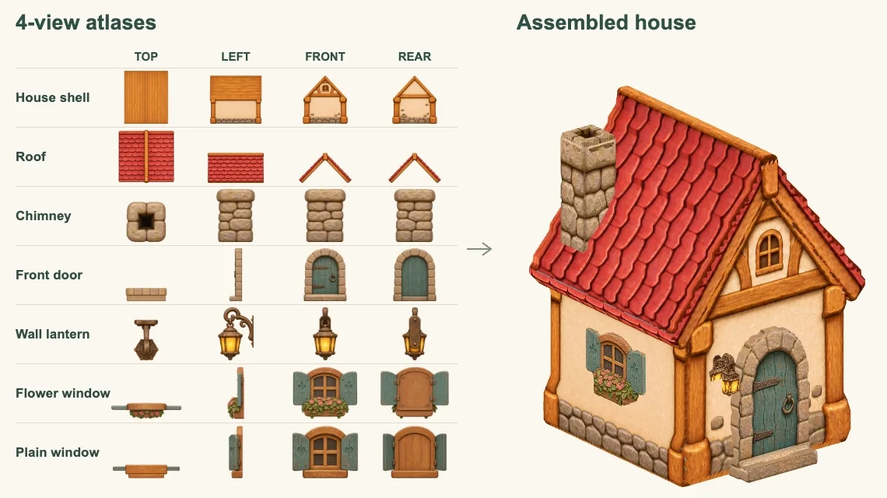
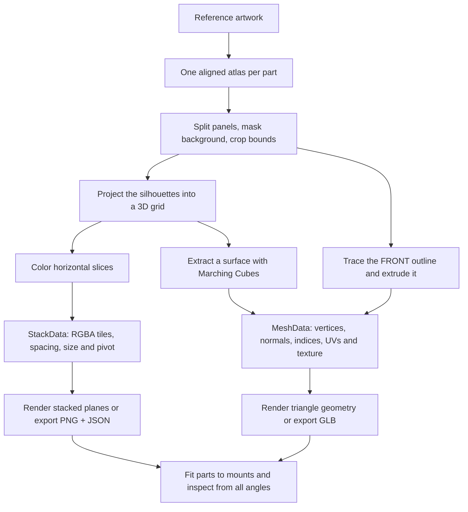
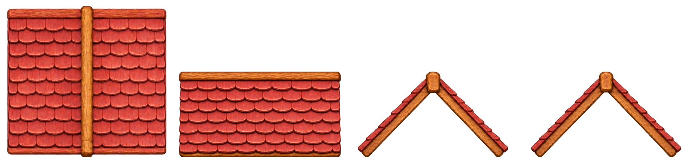
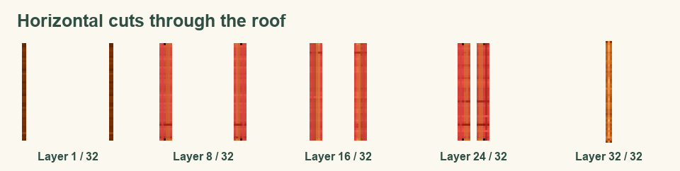
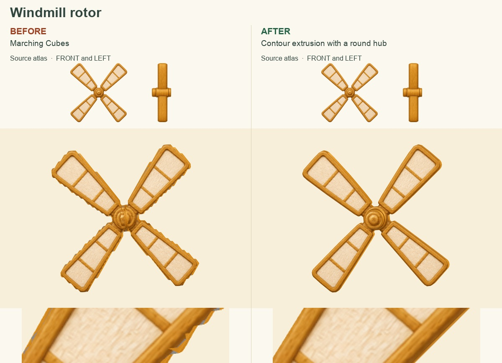
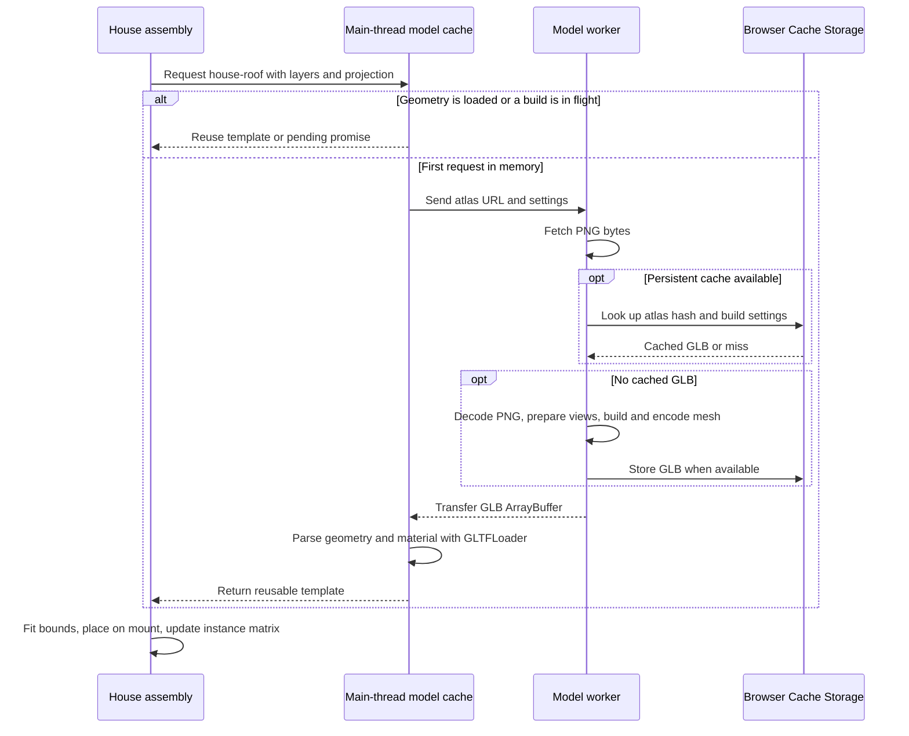

# From a four-view atlas to a running scene

A stack3.js atlas describes **one part from several directions**. Its pixels supply both the silhouette and the paint. The timber house uses seven atlases because the roof, chimney and wall fittings each have their own shape and mounting position. The roof is a useful part to follow through the system. Its TOP looks like a solid rectangle, but its FRONT and REAR show the open space beneath the slopes.



## One input, three reconstruction paths



Choose the output per part. A sprite stack stores colored cross-sections. Marching Cubes uses the same occupancy grid to recover an exterior surface. Contour extrusion follows a separate path for flat parts whose front outline carries most of their shape. The ordinary atlas viewer supports both stacks and meshes. The Petite Town demo assembles **meshes** at runtime. [Core reconstruction](../packages/core/src/reconstruct.ts) · [Petite Town builder](../examples/petite-town/src/build-model.ts)

## 1. Register the drawings



| View | Axes visible in the image | Roof landmark to check |
| --- | --- | --- |
| TOP | Width and depth. The front points down the page. | The ridge runs along the depth axis. Both eaves contribute to the footprint. |
| LEFT | Depth and height. The front points left. | The ridge and eave project as horizontal edges. |
| FRONT | Width and height | The two slopes meet at the ridge. The opening below is transparent. |
| REAR | Width and height, reversed horizontally relative to FRONT | The same ridge height and opening align when mirrored. |

Use the same scale and pose in every drawing. An atlas PNG needs an explicit reading order and clear gutters. A JSON manifest can instead name four individual PNGs. Six-view sets add RIGHT and BOTTOM. The importer accepts transparency directly. For opaque images, it flood-fills light background pixels connected to the border using the background threshold (default 238). This distinction matters for a hole surrounded by stone or timber: explicit alpha can identify that opening even when a border flood-fill cannot reach it.

`splitAtlas` finds the separated panels. `prepareViews` trims each silhouette to pixels with alpha at least 128. `inspectViews` compares the implied proportions. A tilted LEFT view can have the expected bounding dimensions, so also inspect the landmarks in the table. [Input implementation](../packages/core/src/views.ts) · [Orthographic camera guide](../skills/stack3/references/orthographic-views.md)

## 2. Carve the grid

The grid uses width, depth and height. With no explicit size, height defaults to one scene unit. LEFT gives depth from its width-to-height ratio. The builder estimates width twice, once from FRONT and once from TOP and the estimated depth, then averages those estimates. Horizontal resolution sets the sample count on the longer footprint axis. The shorter axis scales proportionally. Layers set the vertical sample count independently.

For every cell center, the builder looks up a pixel in each aligned silhouette. With the four required views, its occupancy rule is:

```text
occupied = TOP covers cell AND LEFT covers cell AND (FRONT OR REAR covers cell)
```

The rear lookup mirrors the horizontal coordinate. With six views, all six projections must cover the cell. The default silhouette profile keeps those survivors. The round profile additionally clips each occupied horizontal cross-section to an ellipse. Grid builds support 16–192 horizontal samples and 8–128 layers, with a maximum of three million cells. [Grid dimensions and occupancy](../packages/core/src/reconstruct.ts)

For the roof above, the CLI measures TOP at 442 × 421 px, LEFT at 448 × 238 px and FRONT at 416 × 238 px. A horizontal resolution of **48** and **32 layers** gives a **47 × 48 × 32** grid. Near the base, the two eaves occupy narrow strips far apart. Higher up, the strips approach one another until they form the ridge. An enclosed feature hidden in every silhouette cannot be recovered from those views alone. Giving the roof its own atlas exposes the opening that the assembled house would conceal.

## 3. Draw the grid as a sprite stack



1. For each occupied cell, neighboring occupancy values estimate which directions its surface faces. The builder samples the available views, weights compatible colors by direction and skips colors that disagree strongly. Flat upper surfaces can take their color from TOP. Empty cells stay transparent.
2. Each height becomes one RGBA tile. Tiles are packed left to right, then onto the next row, starting at ground level. For this roof, all 32 tiles fit on one row. Each tile is 47 × 48 px, making the full texture **1,504 × 48 px**.
3. The stack bundle pairs that texture (`stack.png`) with `stack.json`. The manifest records tile dimensions, columns, layer order, world size, spacing and pivot. Here the spacing is **1/32 of a scene unit**.
4. The Three.js renderer makes one horizontal plane per layer, sharing plane geometry and selecting the corresponding texture rectangle. Plane center height is `(layerIndex + 0.5) × spacing − verticalPivot`. Rotating the group changes the viewpoint while the saved tiles remain reusable.

The stack’s size and pivot metadata use width/depth/height order. The rendered scene is Y-up. Ground pivot places the base at zero; center pivot offsets the layers around the middle. Increasing exported spacing separates the slices and scales the vertical bounds. [Stack packing](../packages/core/src/reconstruct.ts) · [Bundle format](../packages/core/src/export.ts) · [Three.js planes and UVs](../packages/three/src/index.ts)

## 4. Build a textured mesh

**Marching Cubes.** The builder pads the occupancy volume with empty space, combines each cell with its six neighbors to form a scalar field, and extracts the surface at the 0.5 threshold. It interpolates vertices along crossed grid edges and derives normals from field gradients. The roof example produces **20,444 triangles** at the settings above. Raising only the layer count adds vertical samples; a diagonal edge can still show the horizontal grid spacing. [Surface extraction](../packages/core/src/surface.ts)

For texturing, the builder ranks the source views for each triangle by surface direction and checks silhouette coverage. The selected image supplies projected UV coordinates in a packed texture. A geometric vertex can have separate UVs on either side of a projection seam. Mesh positions are converted to Three.js Y-up coordinates. `encodeGlb` packages positions, normals, triangle indices, UVs and the embedded PNG in a binary glTF with an unlit material. Petite Town can apply part-specific processing before encoding, such as reprojecting roof slopes from TOP. [Mesh construction](../packages/core/src/reconstruct.ts) · [GLB encoding](../packages/core/src/export.ts) · [Demo surface processing](../examples/petite-town/src/build-model.ts)

**Contour extrusion.** A flat windmill blade has a long diagonal outline clearly visible in FRONT. The contour builder traces the alpha boundary, preserves holes and separate islands, simplifies the outline, triangulates the caps and joins them with side walls. FRONT and REAR paint the caps. LEFT supplies the overall depth. With the optional centered hub, TOP supplies the thinner blade depth and LEFT supplies the projecting collar dimensions. This method bypasses the occupancy grid, so increasing vertical layers has no effect on its outline. [Contour implementation](../packages/core/src/contour.ts) · [Rotor atlas](../examples/petite-town/atlases/rotor.png)



## 5. Reconstruct in the browser and assemble the house

The general viewer sends the selected atlas, target and settings to a Web Worker. It can return a coarse preview before the final result. It transfers typed-array buffers for either `StackData` or `MeshData` to the main thread. The Three.js adapter can draw these buffers directly. [Viewer worker](../apps/viewer/src/reconstruct.worker.ts) · [Three.js adapter](../packages/three/src/index.ts)

Petite Town takes a different route through the same reconstruction core. Its worker produces GLB bytes, which lets it persist the finished mesh between visits. The published standalone HTML embeds the inputs and worker. The sequence below follows one roof request.



- **Cache identity.** The memory key includes part ID, layers and projection choice. The persistent key also includes a builder fingerprint, SHA-256 of the PNG, profile and resolution. A changed atlas therefore gets a different lookup even if its filename stays the same. Cache Storage is optional; the worker can build and return the buffer directly. [Main-thread cache](../examples/petite-town/src/model-cache.ts) · [Worker and persistent cache](../examples/petite-town/src/model.worker.ts)
- **Fit and placement.** The assembly recipe supplies each part’s target width, height, depth, local position and rotation. The demo scales the measured geometry bounds to those dimensions, reflects Z to face the scene’s forward direction and aligns the bottom center with its mount. A rotating axle uses the bounds center instead. For example, the roof spans **1.95 × 1.45 × 1.95 m** and its bottom center sits at **(0, 1.20, 0)** in house-local coordinates. The chimney has its own mount at **(−0.64, 1.47, −0.58)**. The house group places all seven parts in the village together. [House recipe](../examples/petite-town/src/assemblies.ts) · [Bounds fitting and mounts](../examples/petite-town/src/town-instances.ts)
- **Rendering and edits.** Visible placements with the same template share a Three.js instanced draw object. Orbiting changes the camera. Turning the windmill updates the rotor’s instance matrix. Editing a reconstruction setting requests a matching template, fits the replacement geometry and moves the edited instance to its new batch. A version check prevents an older asynchronous edit from replacing a more recent one. [Instance updates](../examples/petite-town/src/town-instances.ts)

## Reproduce the roof example

Run these commands from the repository root after `npm ci`. They use the same atlas for both outputs and leave the shipped demo assets in place.

```sh
npm run cli -- inspect examples/petite-town/atlases/house-roof.png --layout top,left,front,rear
npm run cli -- build examples/petite-town/atlases/house-roof.png --layout top,left,front,rear --format stack --resolution 48 --layers 32 --output roof-stack/
npm run cli -- build examples/petite-town/atlases/house-roof.png --layout top,left,front,rear --format glb --resolution 48 --layers 32 --output roof.glb
npm run cli -- view roof-stack/
```

Check the gable opening from the front, then orbit to a diagonal and inspect the underside of each slope. Compare the roof alone with the assembled house. A hole lost in the source silhouettes calls for a new view or a part split. Paint crossing an otherwise correct edge calls for checking projection and UVs. The same camera angle before and after each change makes the two cases easier to distinguish. [House assembly animation](media/petite-town/house-atlases-to-mesh.webp) · [CLI reference](../apps/cli/README.md)
