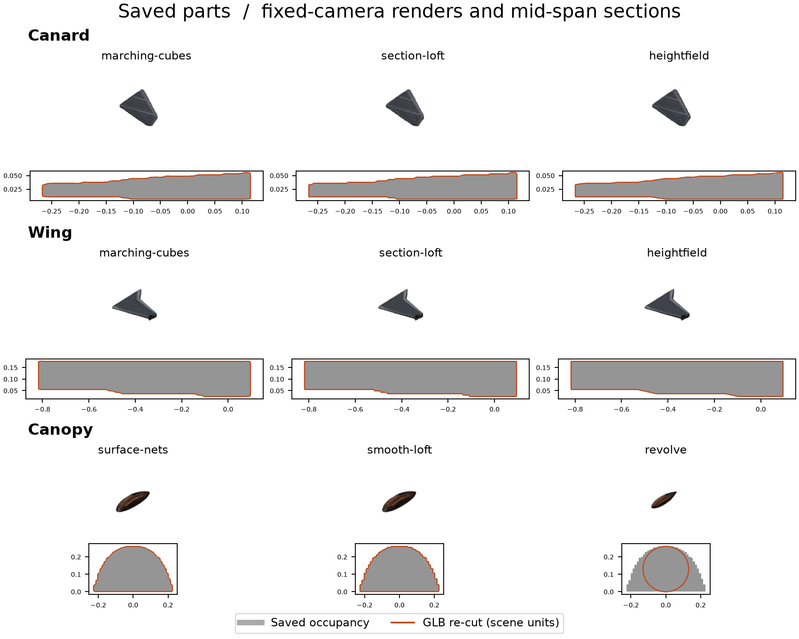

# 부품별 메시 생성 검증

2026-11-26에 저장소의 카나드·날개·캐노피 스택에서 후보 9개, 정답을 정한 합성 스택에서 27개를 실제 CLI로 내보냈다. 아래 수치는 최종 GLB에서 측정했다. 원본 아틀라스와 저장 스택은 읽기 전용 입력으로 사용했다. [구현 명세](../README.md) · [기법별 옵션과 가이드 예제](../../../../skills/stack3/SKILL.md#choose-the-surface-method-per-part) · [측정 원자료](results.json)

## 실행

저장소 루트에서 다음 명령을 사용한다. 첫 명령은 저장소에 이미 있는 날개 스택을 사용한다. 두 번째 기법은 날개 폭 방향인 X축을 가이드로 받는다.

```sh
parts=docs/research/020-aircraft-rendering/part-atlases/stacks
mkdir -p dist
npm run cli -- mesh "$parts/wing" --mesh-method heightfield --output dist/wing-heightfield.glb
printf '%s\n' '{"axis":"x"}' > dist/wing-axis.json
npm run cli -- mesh "$parts/wing" --mesh-method section-loft \
  --guide dist/wing-axis.json --output dist/wing-loft.glb
npm run cli -- mesh --help
```

새 입력은 부품마다 `stack3 build part.png --layout top,left,front,rear --format stack --output part-stack`으로 저장한다. 이어서 `stack3 mesh part-stack`을 실행한다. Blender는 GLB를 재임포트한 다음 마운트 배치와 세부 수정에 쓴다.

## 실제 부품

셀 간격 XYZ는 카나드에서 (0.00719305, 0.00720412, 0.00222985), 날개에서 (0.01360464, 0.01362467, 0.00611063), 캐노피에서 (0.01191658, 0.01180103, 0.00668954) 장면 단위였다. 카나드와 날개 로프트에는 X축, 캐노피 로프트에는 Y축을 지정했다. 캐노피 회전 비교는 Y축과 원점 (0, 0, 0.13)을 사용했다. 회전축은 비교를 위해 지정한 형상 가정이다.

- **체적 IoU**는 셀당 27개 지점에서 스택 점유와 GLB 내부의 교집합을 합집합으로 나눈 근삿값이다. 스택 프레임을 벗어난 메시도 평가 범위에 포함했다.
- **4면 IoU**는 캘리브레이션된 TOP·LEFT·FRONT·REAR 아틀라스의 원래 픽셀 크기로 GLB를 정투영한 실루엣 IoU의 산술평균이다. 평가에는 화면 밖으로 돌출한 형상을 잡을 여백을 뒀다.
- **두께 오차**는 길이 또는 폭의 10·50·90%에 해당하는 슬라이스에서 점유 폭의 가운데 열을 골라 수직 광선으로 잰 값이다. 표에는 메시 두께에서 저장된 점유 두께를 뺀 값을 장면 단위로 표시했다. 중간 단면 오차는 인접 두 슬라이스 사이 절반 위치에서 두 스택 두께의 선형 보간값과 비교했다.

| 부품 | 기법 | 삼각형 | 체적 IoU | 4면 IoU | 세 위치 두께 오차 | 중간 위치 최대 절대 오차 |
| --- | --- | ---: | ---: | ---: | --- | ---: |
| canard | `section-loft` | 29,636 | 98.870% | 95.770% | ≈0, ≈0, ≈0 | 0.001115 |
| canard | `heightfield` | 19,816 | 99.297% | 95.674% | ≈0, +0.000558, ≈0 | 0.000837 |
| canard | `marching-cubes` | 34,904 | 99.050% | 95.902% | ≈0, +0.000082, ≈0 | 0.000170 |
| wing | `section-loft` | 114,844 | 99.188% | 91.830% | ≈0, ≈0, ≈0 | 0.006108 |
| wing | `heightfield` | 43,368 | 99.606% | 91.545% | ≈0, ≈0, ≈0 | 0.001529 |
| wing | `marching-cubes` | 75,448 | 99.493% | 91.699% | ≈0, ≈0, ≈0 | 0.006395 |
| canopy | `smooth-loft` | 157,556 | 99.519% | 98.428% | ≈0, -0.000002, ≈0 | 0.001669 |
| canopy | `surface-nets` | 39,828 | 98.729% | 98.633% | -0.001114, -0.001116, +0.001114 | 0.006692 |
| canopy | `revolve` | 10,752 | 44.585% | 62.646% | -0.066657, +0.000306, -0.093654 | 0.130446 |



각 부품의 첫째 줄은 같은 정투영 카메라·조명에서 160×160픽셀로 렌더한 결과다. 둘째 줄의 회색은 저장 스택, 주황색은 GLB를 다시 자른 경계다. 카나드와 날개는 측정한 모든 열에서 점유가 한 구간이었다. 날개 높이장은 세 지정 위치의 두께를 보존했고 후보 중 삼각형이 가장 적었다. 캐노피는 곡면 로프트의 체적 일치도가 가장 높고 Surface Nets의 4면 실루엣 일치도가 가장 높았다. 회전 후보의 중앙 절단선은 원형이며 원본의 평평한 바닥과 넓은 하단을 재현하지 못했다.

## 합성 스택

| 검사 | 최종 GLB에서 관찰한 결과 |
| --- | --- |
| 비등방 상자와 피벗 | 간격 (0.4, 0.6, 0.9), 피벗 (1, −2, 3). Extended MC와 Hermite DC의 꼭짓점 최대 위치 오차는 4.05×10⁻⁷, 모서리 각도는 90°. 기본 MC의 오차는 0.36749, 최대 인접면 각도는 61.33°. |
| 둥근 계단과 두 겹 | 반지름 6셀 구에서 인접면 각도의 95백분위수 / 최대는 Extended MC 45.00° / 54.74°, Hermite DC 36.20° / 45.73°. 한 셀의 빈 층을 둔 두 판에서 DC가 두 겹의 셀 중심 점유를 모두 복원했다. |
| 입력 단면과 중간 단면 | 12단위 폭 상자의 중간 제어 단면에 폭 6을 지정했다. 직선·곡면 로프트의 GLB 재절단 폭은 첫 제어점 12, 중간 위치 9, 지정 제어점 6이었다. 실제 캐노피는 전체 149개 중간 위치에서도 두께를 측정했다. |
| 관통공과 회전 극점 | MC33과 분기 로프트에서 중심 광선이 관통했다. 첫 절단면에서 안팎 루프를 읽은 경로 스윕과 축 회전에서도 구멍이 유지됐다. 바닥이 막힌 컵은 축에 닿는 바닥과 그 위의 빈 공간을 구분했다. 구멍을 가로지르는 X축 높이장은 다중 점유 열 48개를 보고하고 채웠다. |
| 모호한 MC 셀 | 양의 두 표본이 몸체 대각선에 있는 경우 중심의 삼선형 보간값은 0.25였다. 등값 0.5에서 GLB는 두 성분이었다. 면 대각선은 정확한 0.5 안장점이며 Lewiner의 동률 처리에서는 한 성분이었다. |
| 분기와 병합 | Y자 스택의 두 절단 위치에서 점유 성분이 1→2였다. 가까운 독립 관을 추가한 분기·병합 스택의 세 위치에서는 2→3→2였고, 완성 메시의 연결 성분은 2개였다. |
| 비평행 단면 | 원래 스택이 채운 오목부를 독립 절단선으로 지정했다. 수평·수직 재절단의 하우스도르프 거리는 각각 0.354, 0.354였다. 수평·사선 쌍은 0.354, 0.290이었다. 네 절단선 모두 닫힌 외곽 하나를 복원했다. 허용오차는 1.039 장면 단위였다. |
| 블록·색·균열 | 계단·구멍·독립 섬의 방향별 노출 면 992개를 각각 대조했다. 세 방식 모두 면적과 점유가 일치했다. Greedy와 Monotone은 모든 셀 면의 RGB가 원본과 같았다. 기존 voxel의 UV로 원본 텍셀을 최근접 조회하면 97개가 달랐다. |

| 블록 기법 | GLB 삼각형 | GLB POSITION 정점 |
| --- | ---: | ---: |
| voxel | 1,984 | 3,986 |
| greedy | 76 | 112 |
| monotone | 72 | 108 |

## 구현 선택과 한계

- MC33에는 scikit-image의 Lewiner 구현을 사용해 면과 셀 내부의 모호한 연결 판정을 함께 처리했다. 부품별 새 추출기는 Python에서 실행하고, 저장 번들 판독과 최종 GLB 인코딩에는 기존 코드를 사용한다. 기본 MC·Surface Nets·voxel은 기존 Node 경로로 실행된다. [scikit-image 알고리즘 문서](https://scikit-image.org/docs/stable/api/skimage.measure.html#skimage.measure.marching_cubes)
- Extended MC는 특징 셀의 MC 패치에 정점을 삽입하고 인접 특징 정점 사이의 대각선을 연결한다. Hermite DC는 물리 좌표에서 중심화한 QEF를 풀고 거의 평행한 법선에는 중심점 이탈에 대한 벌점을 준다. 복수 표면을 같은 대표점으로 합쳐야 하는 셀은 오류와 대체 기법을 알린다. 법선은 이진 마스크에서 추정하므로 원래 피사체의 모서리 여부에는 불확실성이 있다.
- 블록 방식은 방향·평면별 텍스처에 저장 RGB를 투영해 긴 면도 원래 도색을 유지한다. 맞닿은 변의 중간 정점을 삽입하고 경계선을 보존하는 삼각화로 T 접합을 제거했다. 992개 면의 면적 검사와 재임포트의 열린 경계 검사가 별도로 이를 확인했다. [제약 삼각화 문서](https://shapely.readthedocs.io/en/stable/reference/shapely.constrained_delaunay_triangles.html)
- 로프트의 단면은 둘레를 유한 개 점으로 재표본화한다. 곡면 로프트는 길이 방향으로 PCHIP 보간하므로 단면 자체의 픽셀 계단은 남을 수 있다. 회전은 지정한 축의 양의 반평면 자오선에 의존한다. 자기 교차하는 스윕과 단면 수가 바뀌는 일반 로프트는 해당 부품의 실패 원인을 출력한다.
- 곡선망은 각 실제 단면의 부호 거리와 스택 거리장을 결합하고, 재절단 오차와 루프 수를 확인한다. 셀 축당 2배, 필요시 4배까지 재표본화하며 한 단계의 상한은 4천만 표본이다. 각 평면에 외곽 하나와 내부 구멍들을 지원한다. 단면의 독립성은 입력 작성자가 보증해야 한다.

분기가 있는 스택의 일반 로프트, 복수 표면 셀의 DC, 자기 교차 스윕, 진행 방향이 반전되는 스윕도 각각 CLI로 실행했다. 네 입력 모두 부품 경로와 원인을 포함한 오류를 반환했고 GLB는 생성되지 않았다.

## 내보내기와 재임포트

Blender 5.2.4 LTS에서 GLB 36개를 각각 새 장면에 불러왔다. 좌표를 같은 위치끼리 묶어 검사한 열린 경계·비매니폴드 변·방향이 뒤집힌 공유 변·면적 0 삼각형은 모두 0개였다. 축 변환 뒤의 경계 상자, 단위 변환 행렬, 피벗 메타데이터, 삼각형 수와 부호 있는 체적을 대조했고 모든 파일에서 UV와 내장 텍스처를 읽었다. 블록의 UV 및 각진 법선 경계에는 렌더 정점이 분리돼 있다. 별도 Blender 에셋 검사에서 Monotone 예제는 통과했고, 같은 좌표의 렌더 정점에 대한 경고가 한 건 있었다.

Khronos glTF Validator는 36개 모두 오류 0개, 경고 0개였다. 파일마다 텍스처 크기가 2의 거듭제곱이 아니라는 정보 메시지가 하나였다. `npm run check`와 `npm test`의 32개 테스트가 통과했다. `npm run package:cli`로 만든 CLI를 Python 환경 캐시만으로 실행해 곡선망 GLB가 작업 트리 CLI의 출력과 바이트 단위로 일치하는 것도 확인했다.

## 재현

Node 22와 uv가 있는 저장소 루트에서 실행한다. 검증용 Python은 trimesh로 GLB를 독립 판독하며 embreex로 광선 검사를 가속한다. 생성 파일은 지정한 출력 디렉터리에 모인다.

```sh
qa=docs/features/part-aware-meshing/validation
out=dist/part-mesh-validation
uv venv dist/part-mesh-qa-env --python 3.13
py="$PWD/dist/part-mesh-qa-env/bin/python"
uv pip install --python "$py" numpy==2.2.6 scipy==1.15.3 scikit-image==0.25.2 shapely==2.1.2 \
  pillow trimesh rtree embreex matplotlib
STACK3_PYTHON="$py" "$py" "$qa/verify.py" "$out"
blender -b --factory-startup --python-exit-code 1 -P "$qa/blender_check.py" -- "$PWD/$out"
"$py" "$qa/review.py" "$out"
npm install --prefix dist/part-mesh-validator gltf-validator
NODE_PATH="$PWD/dist/part-mesh-validator/node_modules" node "$qa/validate-glb.cjs" "$out"
npm run check
npm test
```
