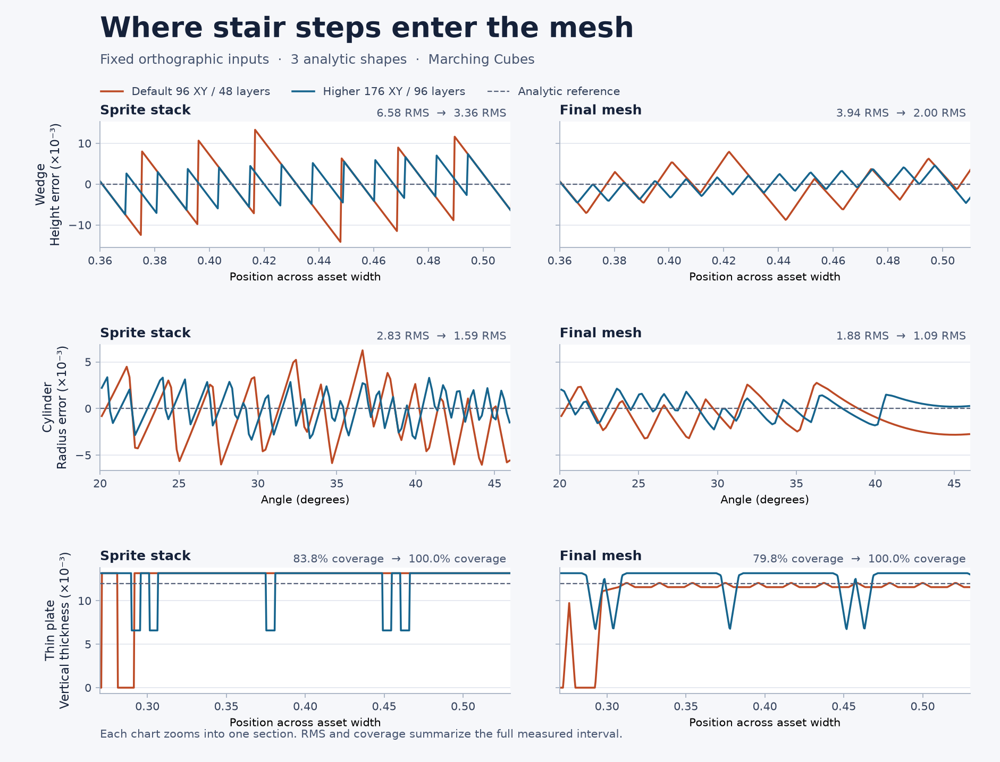

# 010.010 · Resolution baseline

Increasing reconstruction resolution reduced final mesh RMS error by **49% on the wedge** and **42% on the cylinder**. It recovered full coverage at the sampled points on the thin-plate section. This experiment measured the current Marching Cubes path at commit `5ffd9a3ff18e36c875683ecd576b8ac5ee1af53c`.

[Interactive atlas, model, and section comparison](visualizations/resolution-study.html) · [Full measurement data](results.json) · [Benchmark](benchmark.mts)



Open the interactive HTML in a browser. The atlas thumbnails and rendered model views are embedded. The section charts load a pinned chart module over the network. The rotation slider advances through model renders at 15° intervals.

## Method

- Generate transparent TOP, LEFT, FRONT, and REAR orthographic inputs from three analytic shapes at 2,048 pixels per unit. Each shape is one unit wide. The wedge rises from 0.12 to 1.0, the vertical cylinder has radius 0.5, and the sloped plate has a vertical thickness of 0.012.
- Reconstruct each input at **XY 96 / 48 layers** and **XY 176 / 96 layers** using identical world dimensions and a ground pivot. The denser cylinder grid uses 2,973,696 cells, within the 3,000,000-cell limit.
- Compare the source silhouette, occupied sprite-stack cells, and intersections with final mesh triangles against the analytic shape. Sample 2,048 positions per stage. Use one vertical section for the wedge and plate, excluding the outer 5% at each end, and one horizontal section through the cylinder sampled around the full circle.

## Results

RMS values are in thousandths of asset width. Plate coverage is the percentage of sampled locations with nonzero vertical thickness.

| Metric | Input | Sprite stack, default → higher | Final mesh, default → higher |
| --- | ---: | ---: | ---: |
| Wedge height RMS | 0.19 | 6.58 → 3.36 (−49%) | 3.94 → 2.00 (−49%) |
| Cylinder radius RMS | 0.14 | 2.83 → 1.59 (−44%) | 1.88 → 1.09 (−42%) |
| Thin-plate coverage | 100% | 83.8% → 100% | 79.8% → 100% |

The wedge and cylinder deviated most after the image-to-voxel step. Marching Cubes reduced their cross-section error at both resolutions. At default resolution, the plate first lost coverage in the stack and lost more during mesh extraction. At higher resolution, its mesh thickness still ranged from **0.67% to 1.32% of asset width** against a reference thickness of **1.20%**. The denser run used roughly **6.7×** as many grid cells and **3.5–3.8×** as many triangles.

These are single-section measurements on analytic shapes. They establish sampled coverage and profile error. Whole-mesh connectivity, corner retention, and the separate effect of XY resolution and layer count remain open. See the [topic index](../README.md) for follow-up candidates.

## Reproduce the measurements

With the checkout dependencies installed, run from the repository root.

```sh
run_dir=$(mktemp -d)
experiment=docs/research/010-reconstruction-stair-stepping/010.010-resolution-baseline
./node_modules/.bin/tsx "$experiment/benchmark.mts" "$run_dir"
cmp "$experiment/results.json" "$run_dir/results.json"
```

The benchmark writes four input PNGs per shape and a JSON file containing metadata, grid sizes, triangle counts, and all section samples. The JSON records the checkout commit. For an exact comparison after the checkout advances, run the benchmark against the recorded reconstruction revision or compare the measurements after accounting for that metadata field.
