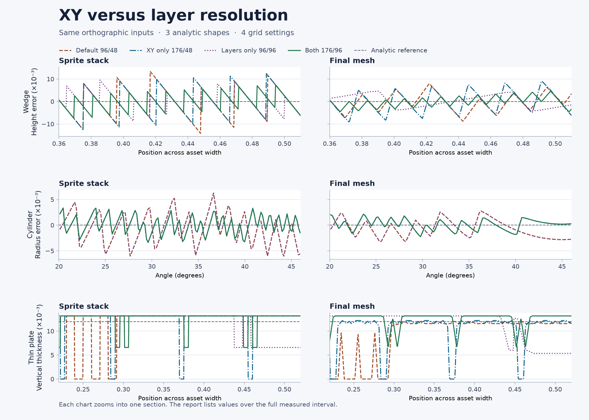

# 010.020 · XY versus layer resolution

Increasing the layer count was more effective for the wedge slope and thin plate. Increasing XY resolution accounted for the cylinder's entire measured radius improvement. This experiment used the same analytic shapes, reconstruction revision, and section samples as [010.010](../010.010-resolution-baseline/README.md).

[Interactive atlas, model, and section comparison](visualizations/resolution-study.html) · [Full measurement data](results.json) · [Benchmark](benchmark.mts)



Open the interactive HTML in a browser. Atlas thumbnails and 15° model views are embedded. The section charts load a pinned module over the network.

## Method

| Configuration | XY resolution | Layers |
| --- | ---: | ---: |
| Default | 96 | 48 |
| XY only | 176 | 48 |
| Layers only | 96 | 96 |
| Both | 176 | 96 |

The same four orthographic images, world dimensions, ground pivot, silhouette profile, and Marching Cubes path were used for each configuration. The benchmark sampled 2,048 locations in one section per shape. The default and both-increased runs matched the corresponding 010.010 values and section samples exactly.

## Wedge and cylinder

RMS values are in thousandths of asset width. Percentages show the change from default at the same stage. The source image RMS was 0.19 for the wedge height and 0.14 for the cylinder radius.

| Metric | Default | XY only | Layers only | Both |
| --- | ---: | ---: | ---: | ---: |
| Wedge height RMS, stack | 6.58 | 6.19 (−6%) | 4.00 (−39%) | 3.36 (−49%) |
| Wedge height RMS, mesh | 3.94 | 4.46 (+13%) | 2.61 (−34%) | 2.00 (−49%) |
| Cylinder radius RMS, stack | 2.83 | 1.59 (−44%) | 2.83 (0%) | 1.59 (−44%) |
| Cylinder radius RMS, mesh | 1.88 | 1.09 (−42%) | 1.88 (0%) | 1.09 (−42%) |

On the wedge, increasing XY alone slightly lowered stack error and raised mesh error. Increasing layers alone lowered both. With the higher layer count in place, increasing XY further lowered mesh error from 2.61 to 2.00. For the vertical cylinder, runs with the same XY resolution matched to floating-point precision on the sampled horizontal section.

## Thin plate

Coverage is the fraction of sampled positions with nonzero vertical thickness. Width is the model width. The input silhouette had 100% coverage and the analytic plate thickness was 1.20% of width.

| Metric | Default | XY only | Layers only | Both |
| --- | ---: | ---: | ---: | ---: |
| Stack coverage | 83.8% | 92.5% | 100.0% | 100.0% |
| Final mesh coverage | 79.8% | 91.3% | 100.0% | 100.0% |
| Longest sampled mesh gap (% of width) | 1.32% | 0.66% | 0.00% | 0.00% |
| Mesh vertical thickness range (% of width, zeros included) | 0.00–1.20% | 0.00–1.22% | 0.53–1.32% | 0.67–1.32% |

XY alone recovered 11.4 percentage points of mesh coverage and halved the longest sampled gap. Layers alone recovered 20.2 percentage points. The vertical sampling interval fell from 1.32% of width at 48 layers to 0.66% at 96 layers, passing below the reference thickness of 1.20%. With 96 layers in both runs, increasing XY raised the minimum sampled mesh thickness from 0.53% to 0.67% of width.

## Cost and limits

Relative to each shape's default, XY alone used about 3.35× the grid cells and 2.5–3.0× the triangles. Layers alone used 2× the cells and 1.47–1.56× the triangles. Increasing both used about 6.7× the cells and 3.5–3.8× the triangles.

These results describe one section per synthetic shape. Whole-mesh connectivity, corner retention, and sensitivity to slope, orientation, and sub-voxel placement are open. For feature-preserving methods at matched grid budgets, see [010.030 in the topic index](../README.md#findings-and-candidates).

## Reproduce the measurements

With the checkout dependencies installed, run from the repository root.

```sh
run_dir=$(mktemp -d)
experiment=docs/research/010-reconstruction-stair-stepping/010.020-xy-vs-layer-resolution
./node_modules/.bin/tsx "$experiment/benchmark.mts" "$run_dir"
cmp "$experiment/results.json" "$run_dir/results.json"
```

The script uses the 010.010 measurement code and writes four input PNGs per shape and a JSON file with all section samples. Add `--glb` after the output directory to export the twelve reconstructed meshes. The JSON includes the checkout commit. For a byte-for-byte comparison, the recorded revision and measurement environment must match.
