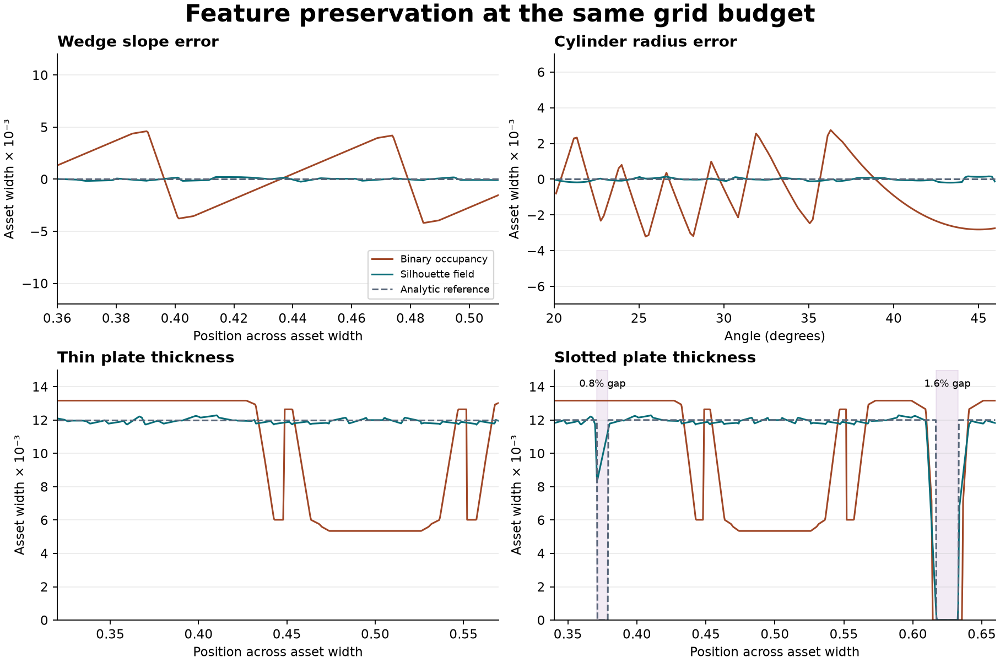

# 010.030 · Feature preservation at equal voxel budgets

At the same grid size, reconstructing from a source-resolution silhouette distance field reduced wedge slope, cylinder radius, and thin-plate thickness RMS by about 95–96%. Corner and gap measurements exposed two limits. The high wedge corner moved farther from the reference, and the narrower slot stayed closed.

[Interactive atlas, model, and section comparison](visualizations/resolution-study.html) · [Full measurements](results.json) · [Benchmark](benchmark.mts) · [Experimental extractor](silhouette-field.mts)



Open the interactive HTML in a browser. Atlas thumbnails and 15° model views are embedded. Section charts load a pinned module over the network.

## Method

- Use the same wedge, vertical cylinder, and 1.20%-of-width sloped plate from [010.020](../010.020-xy-vs-layer-resolution/README.md). Add a copy of the plate with two through-slots across its full depth. The slots are centered at 37.5% and 62.5% of asset width, with widths of 0.80% and 1.60%.
- Fix **XY 96 / 96 layers** for both methods. This gives **534,528** interior samples for the wedge and each plate, and **884,736** for the cylinder. Keep the source rasters, view orientations, world dimensions, and pivot fixed. The two methods use the same padded grid and Marching Cubes case table. The cell budget covers the 3D grid. The candidate additionally computes 2D fields at source resolution and reevaluates the field along edges.
- The baseline uses the production reconstruction from binary occupancy. The candidate computes signed distances from padded alpha masks, bilinearly samples each view, and combines them with the same silhouette Boolean rule using min and max. Marching Cubes picks active edges from the grid signs. The prototype bisects the source field along each active edge to place its vertex. It uses silhouette pixels without analytic shape parameters.
- Sample 2,048 locations on the same section as 010.020. Measure each wedge corner as the shortest distance from the analytic corner to a reconstructed section segment. Measure plate thickness vertically and compute RMS over expected solid locations, with missing material counted as zero thickness. For each slot, estimate the width of the contiguous empty interval through its center. Count connected components of the full mesh after welding triangle vertices at a precision of 1e-6 in scene units.

## Results

Length errors in the first table are in thousandths of asset width. Lower is better.

| Mesh metric | Binary occupancy | Silhouette distance field |
| --- | ---: | ---: |
| Wedge slope height RMS | 2.61 | **0.10 (−96%)** |
| Distance to wedge's low corner | 0.43 | **0.15 (−65%)** |
| Distance to wedge's high corner | **4.26** | 5.16 (+21%) |
| Cylinder radius RMS | 1.88 | **0.08 (−96%)** |
| Thin-plate thickness RMS | 2.36 | **0.13 (−95%)** |

| Plate metric | Reference | Binary occupancy | Silhouette distance field |
| --- | ---: | ---: | ---: |
| Plain plate thickness range, % of asset width | 1.20% | 0.53–1.32% | **1.17–1.23%** |
| Open width at the 1.60% slot | 1.60% | 2.15% | **1.54%** |
| Open width at the 0.80% slot | 0.80% | 0.00% | 0.00% |
| Full slotted-plate mesh components | 3 | 2 | 2 |

The wider slot's width error fell from 0.55 to 0.06 percentage points of asset width. The binary mesh covered the full intended opening but removed extra plate material. The candidate left about 95% of the intended opening empty and reduced excess removal at the slot edges. The narrower slot lies between two X sample centers, so the grid signs did not expose a crossing there. Full-mesh component counts confirm that both reconstructions retained only one through-slot.

Both meshes had 100% coverage on the measured section of the plain plate. Triangle counts stayed within 12 per asset and the cylinder counts matched exactly. These were matched-grid runs. The prototype's extra source-field computation and edge evaluations were outside the grid budget, and runtime and peak memory were outside the measurements.

The result supports the distance field as a candidate for surfaces and thickness. The upper corner result motivates reconstruction that retains intersections of constraints. Recovering a gap that falls between sample centers requires a way to represent multiple crossings or spend some of the grid budget on local refinement. The observed limits apply to these test shapes and slot placements.

## Reproduce the measurements

With checkout dependencies installed, run from the repository root.

```sh
run_dir=$(mktemp -d)
experiment=docs/research/010-reconstruction-stair-stepping/010.030-feature-preservation
./node_modules/.bin/tsx "$experiment/benchmark.mts" "$run_dir"
cmp "$experiment/results.json" "$run_dir/results.json"
```

The benchmark writes the four orthographic PNGs for every asset and JSON containing the revision, sampling grid, metrics, and section samples. Add `--glb` to export both meshes per asset. For a byte-for-byte comparison, use the recorded reconstruction revision and the same measurement environment.
