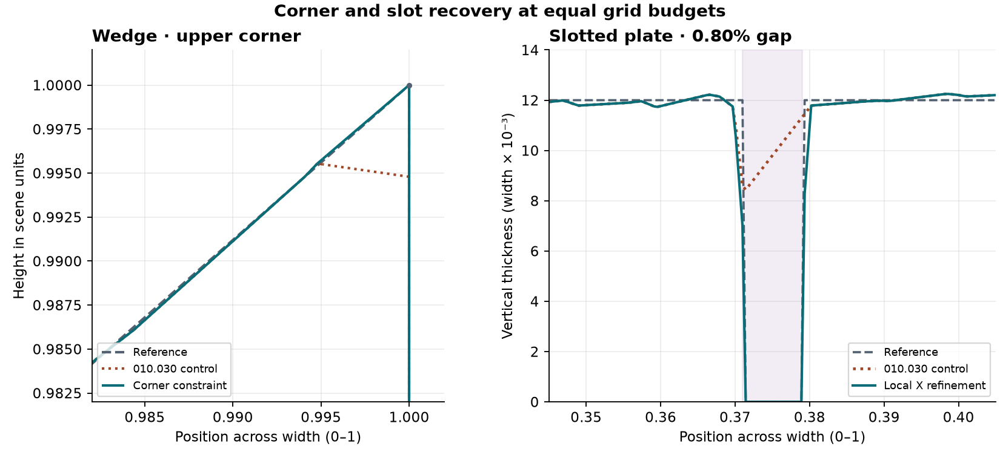

# 010.040 · Corner constraints and local refinement

At the same grid budget as [010.030](../010.030-feature-preservation/README.md), a ridge constraint brought the measured wedge corner within a source pixel of its reference. Moving one X sample plane recovered the narrow through-slot at **0.791% of asset width** against a **0.80%** reference, restoring all three connected components.

[Interactive atlas, model, and section comparison](visualizations/resolution-study.html) · [Full measurements](results.json) · [Benchmark](benchmark.mts) · [Experimental constraints](constraints.mts)



Open the interactive HTML in a browser. Four orthographic thumbnails and model views at 15° intervals are embedded. The slot chart loads a pinned chart module over the network.

## Method

Use the wedge and the slotted plate from 010.030. Run four configurations: the uniform silhouette-field control, corner constraint alone, local X refinement alone, and both together. Every run uses **96 × 58 × 96 interior grid positions (534,528)** and **98 × 60 × 98 positions including padding (576,240)**. The candidate methods use the same input masks, world dimensions, and pivot.

- **Corner constraint.** Fit a line to the last eighth of the opaque upper FRONT silhouette, with a small inset from the right edge. Intersect the fit with the visible right wall. Split the triangles that cross the chamfer bisector near this ridge and place the new shared vertices on the ridge. Taper the displacement near both depth ends. Apply this prototype constraint to the depth-extruded wedge.
- **Local X refinement.** Find openings in TOP whose alpha is zero through the entire projection depth. Place an X plane in each detected opening that contains no uniform sample, donating a plane from solid material farthest from openings and outside edges. In this run the plane moved from **81.77%** to **37.50%** of width. Local X spacing went from **1.042%** to **0.521%** of width. The donor region's spacing became **2.083%**. This reallocates full-depth X planes and keeps Y and Z sampling fixed.
- **Measurements.** Reuse the 010.030 section and gap metrics. Compare the nearest distance from the analytic wedge corner to the section, the contiguous opening width through the slot center, and welded whole-mesh component counts. Check indexed triangle edge incidence, winding consistency across shared edges, and degeneracy.

## Results

The corner distance is expressed in thousandths of asset width. The narrow slot reference is 0.80% of width. The slotted reference has three connected components.

| Mesh metric | 010.030 control | Corner constraint | Local X refinement | Both |
| --- | ---: | ---: | ---: | ---: |
| Wedge upper-corner distance | 5.155 | **<0.01** | 5.155 | **<0.01** |
| Wedge slope RMS, excluding outer 5% | 0.101 | 0.101 | 0.101 | 0.101 |
| Measured narrow slot width | 0.000% | 0.000% | **0.791%** | **0.791%** |
| Measured wider slot width (1.60% reference) | 1.538% | 1.538% | 1.538% | 1.538% |
| Slotted-plate connected components | 2 | 2 | **3** | **3** |
| Wedge triangles | 65,188 | 65,412 | 65,188 | 65,412 |
| Slotted-plate triangles | 44,072 | 44,072 | 44,060 | 44,060 |

The line fit estimates the ridge height at 1.000003 in scene units, close to the analytic 1.0. The section distance is below the resolution of the source pixels. The corner constraint adds 112 vertices and 224 triangles on the wedge without changing the grid. Local refinement opens the expected 0.80% gap and leaves the wider slot's measured width unchanged. On the slotted plate, the vertical-thickness RMS over expected solid locations increases slightly from 0.700 to 0.713 thousandths of width.

All eight meshes had zero boundary edges, edges shared by more than two triangles, inconsistent shared-edge orientations, and triangles with area at or below 1e-12 scene units squared. The control sections and triangle counts match the archived 010.030 silhouette-field runs.

These are targeted prototypes. The wedge results cover one depth section and one detected upper-right ridge. The slot detector covers through-gaps spanning full depth in TOP, with a one-axis sampling trade-off in the donor area. Runtime, peak memory, and generalization to diagonal or partially occluded gaps remain open.

## Reproduce the measurements

With checkout dependencies installed, run from the repository root.

```sh
run_dir=$(mktemp -d)
experiment=docs/research/010-reconstruction-stair-stepping/010.040-corner-constraints-and-local-refinement
./node_modules/.bin/tsx "$experiment/benchmark.mts" "$run_dir"
cmp "$experiment/results.json" "$run_dir/results.json"
```

The benchmark regenerates the orthographic PNGs and the JSON. Add `--glb` after the output directory to export the eight reconstructed meshes. A byte-for-byte comparison includes the checkout revision recorded in the JSON.
