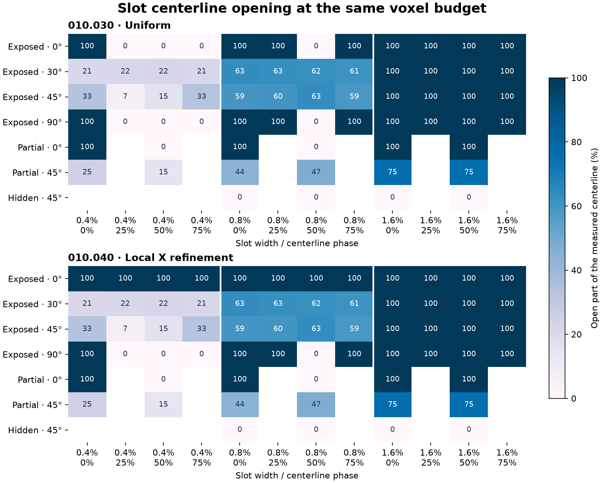
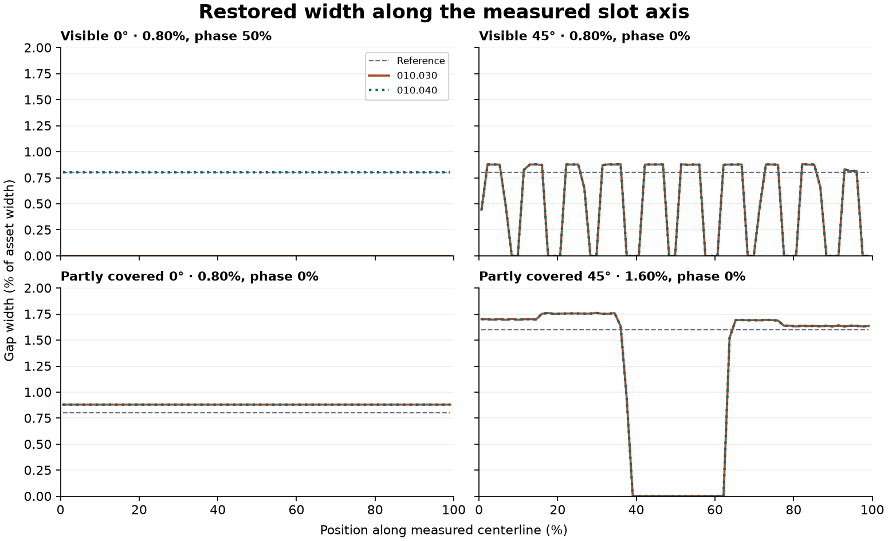

# 010.050 · Slot width, direction, phase, and visibility

At the same voxel budget, 010.040 restored **four additional continuous openings** across 64 conditions. All four were visible in TOP as gaps spanning the full plate depth. Diagonal and partially covered slots exposed the limits of redistributing only whole X planes.

[Interactive sweep, atlases, and models](visualizations/resolution-study.html) · [Full measurements](results.json) · [Benchmark](benchmark.mts)





Open the interactive HTML in a browser. Select TOP visibility and a slot normal angle, then choose a width and phase from the grid. The input views and oblique and overhead model renders are embedded. The width profile loads a pinned chart module over the network.

## Method

- Compare the uniform silhouette distance field from [010.030](../010.030-feature-preservation/README.md) and the unchanged TOP-driven X-plane redistribution from [010.040](../010.040-corner-constraints-and-local-refinement/README.md). Both use **96 × 58 × 96** interior samples (**534,528**) and the same calibrated masks, padding, world dimensions, and pivot. The wedge-specific corner constraint has no role in these fixtures.
- Use a flat plate with a through-slot. Its 1.20%-of-width thickness and world grid dimensions match the earlier plate setup. Generate four calibrated orthographic silhouettes at 1,024 pixels per unit. A separate raised plate or strip provides TOP occlusion while leaving the actual lower slot open. The explicit world calibration stays fixed across views and cases.
- The slot angle describes its **normal from +X**, so a 0° slot runs along depth, and a 90° slot runs along width. Shift the slot from a designated grid center along its normal by 0%, 25%, 50%, or 75% of the projected grid pitch. The pitch is the root-sum-square of X and Y sample spacings weighted by the normal components. A diagonal phase is relative to that anchor, so many grid rows can have different local alignments.
- Measure the open fraction of the analytic centerline by intersecting the lower plate's horizontal mesh section with that line and integrating the empty intervals. Trim 2% of asset width from each end along the centerline. Also measure width at 65 perpendicular probes. Call a case continuous when the entire tested centerline is open and all probes have solid material on both sides of the opening. This classification concerns the tested section.

| TOP visibility | Normal angles | Slot widths (% of asset width) | Grid phases | Cases |
| --- | --- | --- | --- | ---: |
| Exposed | 0°, 30°, 45°, 90° | 0.40%, 0.80%, 1.60% | 0%, 25%, 50%, 75% | 48 |
| Partly covered | 0°, 45° | 0.40%, 0.80%, 1.60% | 0%, 50% | 12 |
| Fully covered | 45° | 0.80%, 1.60% | 0%, 50% | 4 |

For all four fully covered fixtures, the script also renders a plate with the same raised occluder and no slot. The four input masks match the slotted fixture byte for byte.

## Results

### Exposed slots

Numbers are continuous cases out of the four tested phases for each width and normal angle.

| Normal angle | 0.40%, 010.030 → 010.040 | 0.80%, 010.030 → 010.040 | 1.60%, 010.030 → 010.040 |
| --- | ---: | ---: | ---: |
| 0° | **1 → 4** | **3 → 4** | 4 → 4 |
| 30° | 0 → 0 | 0 → 0 | 4 → 4 |
| 45° | 0 → 0 | 0 → 0 | 4 → 4 |
| 90° | 1 → 1 | 3 → 3 | 4 → 4 |

At 0°, every recovered condition used one donated X plane. For example, the 0.80% slot at phase 50% went from closed to continuous and had a median restored width of 0.801%. At 90°, the analogous unsampled slot stayed closed because the method only reallocates X planes.

At 30° and 45°, neither method produced a continuous 0.40% or 0.80% opening. The 0.40% slot at 45° was particularly sensitive to phase, with **6.6–33.3%** of its tested centerline open. For 0.80%, approximately **61–63%** of the tested 30° centerline and **59–63%** of the tested 45° centerline were open. All eight exposed 1.60% diagonal cases were continuous. The two methods produced identical diagonal meshes because the TOP lookup found zero completely empty X columns.

### Occluded slots

- **Partly covered, 0°.** The lower gap remained visible in FRONT and REAR. The 0.40% and 0.80% slots were continuous at phase 0% and closed at phase 50%, including the band hidden in TOP. The 1.60% slot stayed continuous at both phases. Since no TOP column was completely empty, the phase-50% failures received no refinement.
- **Partly covered, 45°.** No other silhouette exposed the gap under the raised strip. The 1.60% slot was continuous when exposed, and was open along about **75%** of the tested centerline under partial cover. Every measured probe in the covered band was closed. The values were identical for both methods.
- **Fully covered, 45°.** Both widths and phases stayed closed in both reconstructions. The three-dimensional reference has a slot, and the no-slot witness produces the same four silhouettes. These inputs provide no evidence that distinguishes the two shapes.

Overall the continuous count rose from **28 to 32 of 64**. The fraction is a count of these synthetic cases. The apparent width threshold depends on direction, sampling phase, visibility, and the input raster. The sweep measures one height section with controlled orthographic images. It leaves whole-mesh connectivity, additional views, and runtime outside scope.

## Reproduce the measurements

With checkout dependencies installed, run from the repository root.

```sh
run_dir=$(mktemp -d)
experiment=docs/research/010-reconstruction-stair-stepping/010.050-slot-sweep
./node_modules/.bin/tsx "$experiment/benchmark.mts" "$run_dir"
cmp "$experiment/results.json" "$run_dir/results.json"
```

The JSON contains fixture settings, moved sample positions, section intervals, per-probe widths, triangle counts, and the checkout revision. Add `--glb` to write both meshes and the four orthographic PNGs for every fixture.
