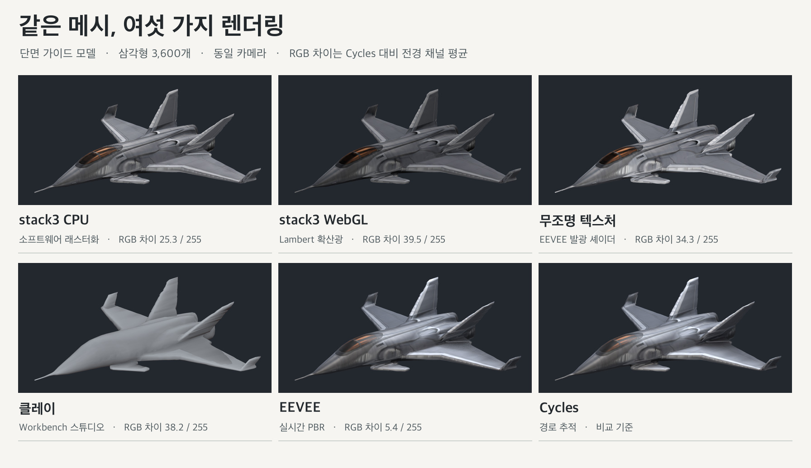

# 항공기 스프라이트 스택과 렌더러 비교

[최종 Blender 모델](industrial-joints/Aircraft-Industrial.blend) · [접합부 전후](industrial-joints/comparison.jpg) · [모델링 마감 비교](blender-polish/comparison.jpg) · [단일 모델과 파츠 모델 비교](version-comparison/comparison.jpg) · [재질 실험](surface-detail/README.md)

첨부된 사선 사진을 기준으로 재구성한 항공기다. 같은 메시의 재질 표현은 캐노피 하이라이트와 날개 앞전에서 가장 쉽게 구분할 수 있다. 꼬리날개 수와 기수 길이는 재구성 단계에서 달라졌다.



[Cycles 전체 크기 캡처](captures/aircraft-cycles.png) · [원본과 다섯 메시](captures/meshes.jpg) · [꼬리 확대와 오차 지도](captures/silhouette.jpg) · [12방향 회전 캡처](captures/orbit.jpg) · [스프라이트 스택 캡처](captures/stacks.jpg)

[수평·수직·교차 단면의 후속 비교](layer-axes/README.md)에서 같은 기체의 스프라이트와 메시를 20개 카메라로 대조했다.

[단면 가이드와 조명 끔·켬 비교](guide-comparison/README.md)에는 엔진과 앞동체의 실제 단면, 각 렌더러의 전후 캡처가 있다.

[부위별 가이드로 복원한 엔진 입구](local-guides/README.md)에서 날개 단면을 유지한 채 만든 오목한 단면과 기존 모델을 비교했다.

[부품별 독립 아틀라스와 Blender 조립 파일](part-atlases/README.md)에는 6개 입력 이미지, 10개 파츠, 조립·분해 애니메이션이 있다.

## 사진에서 메시까지

1. 첨부 사진을 참조해 내장 ImageGen으로 TOP, LEFT, FRONT, REAR 정투상 이미지를 생성했다. TOP의 기수는 아래로, LEFT의 기수는 왼쪽으로 향한다. 정면에서는 캐노피와 흡입구, 후면에서는 배기구 두 개가 보인다. 네 뷰의 원래 외곽 크기는 각각 457 × 583, 635 × 149, 474 × 164, 470 × 150픽셀이다. 뷰별로 균일 배율을 적용하고 주날개의 높이를 맞췄다. [사진](inputs/reference.jpg) · [생성한 원본 아틀라스](inputs/four-views.png) · [생성 프롬프트](inputs/prompt.txt) · [정렬값](inputs/registration.json)
2. 네 마스크가 동시에 채워진 위치를 취해 기본 스프라이트 스택을 만들었다. 투명 여백까지 정렬을 유지하도록 stack3 코어의 `reconstructPrepared`를 사용했다. 151 × 192픽셀, 72층, 바닥 피벗 (0, 0, 0)이다. 장축 6은 비교를 위한 임의 장면 단위다. 아래 첫 네 방식의 형상 입력은 디스크에서 다시 읽은 동일한 PNG의 알파다. [기본 스택](stack/stack.json) · [레이어 PNG](stack/stack.png)
3. 다섯 번째 실험에서는 같은 네 이미지에 기체별 단면 가정을 추가했다. 동체·엔진의 타원 단면, 주날개 두께, 꼬리날개의 뿌리와 끝 위치를 영상 좌표로 지정했다. 셀 안 16개 표본으로 각 수평 레이어의 알파를 기록했다. 격자보다 가는 기수 끝은 TOP과 LEFT에 실제로 보이는 위치에서 셀 하나를 보존했다. 이 스택도 PNG로 저장해 다시 읽고, 평활화한 Marching Cubes와 QEM으로 메시화했다. 동일한 네 뷰의 색을 연속 혼합해 개별 UV에 구웠다. [단면 가이드 스택](section-stack/stack.json) · [레이어 PNG](section-stack/stack.png) · [단면 가정](scripts/sections.py)

## 메시의 차이

| GLB | 삼각형 | 사진 실루엣 IoU ↑ | 입력 4면 평균 IoU ↑ | 해당 스택과 3D IoU ↑ | 사진 윤곽 거리 P95 ↓ |
| --- | ---: | ---: | ---: | ---: | ---: |
| [복셀 경계면](models/voxel.glb) | 76,252 | 70.09% | 89.24% | 100.00% | 58.3px |
| [기존 Marching Cubes](models/marching-cubes.glb) | 76,248 | 70.51% | 89.74% | 98.70% | 57.2px |
| [Surface Nets](models/surface-nets.glb) | 76,252 | 70.63% | 88.38% | 93.29% | 64.4px |
| [Surface Nets + QEM](models/surface-nets-qem.glb) | 3,506 | 70.63% | 88.33% | 93.15% | 67.4px |
| [부위별 단면 가이드](models/section-loft.glb) | 3,600 | 73.00% | 77.50% | 94.06% | 52.7px |

기본 스택의 꼬리에는 전면의 좌우 위치와 측면의 앞뒤 위치가 잘못 짝지어진 돌출부가 생겼다. 복셀 경계면은 층의 계단을 그대로 보인다. 기존 stack3 Marching Cubes는 셀 사이 경계면을 보간한다. Surface Nets는 인접 셀의 표면을 연결한 뒤 이동량을 제한해 평활화했다. QEM은 이 표면에서 삼각형 수를 줄였고, 접혀서 겹친 면과 단순화 중 떨어져 나온 기수 조각을 정리했다. 이 정리까지 끝난 GLB로 모든 값을 측정했다. [VTK Surface Nets](https://vtk.org/doc/nightly/html/classvtkSurfaceNets3D.html) · [Garland와 Heckbert의 QEM](https://www.cs.cmu.edu/~garland/quadrics/)

단면 가이드는 꼬리의 이중 윤곽을 줄여 사진 IoU가 기존 Marching Cubes보다 **2.49%p** 높았다. 기수와 주날개 앞전의 위치 차이는 남았다. 정면·후면 두께도 생성한 입력과 다르다. 이 모델의 TOP IoU는 98.09%, FRONT는 65.90%다. 마지막 행에서는 **입력 스택과 텍스처 처리도 바뀐다**. 위쪽 네 행이 동일한 스택에서 메시 추출 방식을 대조한 실험이다. [오차 지도](captures/silhouette.jpg) · [전체 측정값](results.json)

### 오차를 읽는 방법

- 사진 IoU는 렌더의 전경과 첨부 사진의 기체 마스크가 겹치는 면적을 두 마스크의 합집합으로 나눈 값이다. 사진 외곽을 따라 찍은 점들과 좁은 GrabCut 보정대로 마스크를 구했다. 기수·배기구·날개 끝으로 직교 카메라의 초기값을 구하고 기본 복셀 표면과 사진의 겹침으로 한 번 정합한 뒤 다섯 모델에 고정했다. 한 장의 이미지에 맞춘 값이며, 실제 카메라와 원본 3D 형상은 미상이다. P95는 한쪽 윤곽의 각 픽셀에서 상대 윤곽까지 가장 가까운 거리를 양방향으로 모아 구했다. 기준 해상도는 1,280 × 714다. [사진 마스크](inputs/reference-mask.png) · [고정 카메라](inputs/camera.json)
- 입력 4면 IoU는 각 GLB의 삼각형을 정렬된 정투상 이미지에 4배 해상도로 투영한 후 면적 축소해 구했다. 네 뷰를 같은 가중치로 평균했다. 복원에 사용한 뷰의 재투영 적합도다.
- 스택 3D IoU는 GLB를 독립적인 VTK 스텐실로 다시 채워 원래 스택 점유와 비교했다. 셀 하나당 3 × 3 × 3 지점을 표본화했고 스택 점유 기준은 알파 128 이상이다. 복셀 경계면을 되채웠을 때 원래 점유와 100% 일치하는지도 검사했다.
- **실제 3D 정답이 있는 대조 실험**에는 축 길이를 알고 있는 타원체를 썼다. 정확한 정투상 이미지에서 스택을 추출하고 같은 네 기법을 실행했다. 입력 4면 IoU가 99.14~99.66%여도 실제 타원체와의 3D IoU는 89.19~89.61%였으며 부피는 11.45~11.84% 크게 복원됐다. 실루엣으로 가려진 곡면의 부피까지 판별하기 어려운 예다. [타원체 실측값](control.json)

## 렌더러의 차이

아래 여섯 화면은 **동일한 3,600삼각형 GLB**를 읽어 촬영했다. EEVEE PBR과 Cycles는 동일한 Principled 재질, 면광원 세 개, 월드 조명, Standard 색 변환을 사용했다. 나머지 네 화면은 각 모드에서 사용하는 조명과 재질의 차이까지 보여준다. Cycles 프레임을 기준으로 공통 전경 안쪽의 8비트 sRGB 채널 절대차를 평균했다. 이 수치는 렌더 간 색 차이다. [Blender 렌더 엔진 개요](https://docs.blender.org/manual/en/5.2/render/render_engines.html)

| 렌더 방식 | 조건 | RGB 평균 절대차 / 255 |
| --- | --- | ---: |
| stack3 CPU | 재질 조명, 디테일 노멀, 스펙큘러 AA, 4표본 서브픽셀 AA | 25.26 |
| stack3 WebGL | Lambert, 주변광과 방향광 | 39.51 |
| EEVEE 무조명 | 원색 텍스처를 발광으로 출력 | 34.31 |
| Workbench 클레이 | 단색 스튜디오 조명과 굴곡 음영 | 38.16 |
| EEVEE PBR | 래스터화, 32표본 | 5.39 |
| Cycles | 경로 추적, 64표본, 디노이즈 | 0.00 |

stack3 CPU는 실제 뷰어의 CpuPreview, WebGL은 뷰어의 Three.js Lambert 재질 전환과 조명 설정을 사용했다. Chromium의 WebGL 경로는 SwiftShader로 실행했다. CPU 프레임은 뷰어 내부 제한으로 1,024 × 571이며 측정할 때 1,280 × 714로 리샘플링했다. PBR 두 프레임 간 실루엣 IoU는 99.96%다. 금속 표면의 명암과 광택 변화가 색 차이 대부분을 차지한다.

## 파일 검증

Khronos glTF Validator에서 다섯 GLB 모두 오류 0개, 경고 0개였다. Blender에서 다시 불러와 재질과 형상을 검사하고 대표 모델을 30° 간격으로 한 바퀴 촬영했다. 대표 GLB는 연결된 한 컴포넌트로, 열린 경계와 퇴화한 형상 삼각형이 0개였다. UV 면적이 0인 삼각형 세 개와 근접 중복 정점 경고 하나가 남았다. 기본 네 모델의 투영 UV는 여러 면이 같은 원본 텍셀을 공유한다. 복셀은 평면 노멀을 위해 정점을 분리하며, 평활화만 한 Surface Nets에는 서로 등을 맞댄 면 두 쌍이 검출됐다. 모델을 공중에 둔 공통 좌표계 때문에 바닥 높이 경고도 기록된다. 메시·렌더 비교용 결과물이다. [glTF 검사 결과](gltf-validation.json) · [Blender 검사 결과](blender-qa.json)

## 재현

저장소 루트에서 실행한다. 이 실험을 기록한 코어 리비전은 `e916cb0`, Blender는 5.2.4, Python은 3.12.9다. 프로젝트의 npm 의존성, Chrome, Blender CLI가 필요하다. 캡처 보드의 한글 글꼴은 macOS Apple SD Gothic Neo를 사용한다.

```sh
repo_root="$PWD"
exp="$repo_root/docs/research/020-aircraft-rendering"
scratch_dir=$(mktemp -d)
uv venv "$scratch_dir/env" --python 3.12
py="$scratch_dir/env/bin/python"
uv pip install --python "$py" -r "$exp/requirements.txt"
blender_bin="/Applications/Blender.app/Contents/MacOS/Blender"

"$py" "$exp/scripts/prepare.py"
"$repo_root/node_modules/.bin/tsx" "$exp/scripts/stack.mts" "$scratch_dir"
"$py" "$exp/scripts/camera.py"
"$py" "$exp/scripts/sections.py"
"$py" "$exp/scripts/meshes.py" "$scratch_dir"
"$py" "$exp/scripts/meshes.py" "$scratch_dir" --sections
"$blender_bin" -b --factory-startup --python-exit-code 1 -P "$exp/scripts/render.py" -- "$scratch_dir/render"

# 다른 터미널에서 저장소 루트의 Vite를 실행해 둔다.
# ./node_modules/.bin/vite --host 127.0.0.1 --port 4387 --strictPort
"$py" "$exp/scripts/browser.py" http://127.0.0.1:4387/docs/research/020-aircraft-rendering/scripts/runtime.html "$scratch_dir/render"
"$py" "$exp/scripts/measure.py" --render "$scratch_dir/render" --out "$exp/results.json"
"$py" "$exp/scripts/figures.py" "$scratch_dir/render"

"$py" "$exp/scripts/control.py" "$scratch_dir/control"
(
  export STACK3_BENCH_ROOT="$scratch_dir/control"
  "$repo_root/node_modules/.bin/tsx" "$exp/scripts/stack.mts" "$scratch_dir/control/raw"
  "$py" "$exp/scripts/meshes.py" "$scratch_dir/control/raw"
  "$py" "$exp/scripts/measure.py" --out "$exp/control.json"
)

npm install --prefix "$scratch_dir/validator" gltf-validator@2.0.0-dev.3.10
NODE_PATH="$scratch_dir/validator/node_modules" node "$exp/scripts/validate.cjs"
"$blender_bin" -b --factory-startup --python-exit-code 1 -P "$exp/scripts/qa.py" -- "$HOME/.agents/skills/blender-asset-qa/scripts"
```
