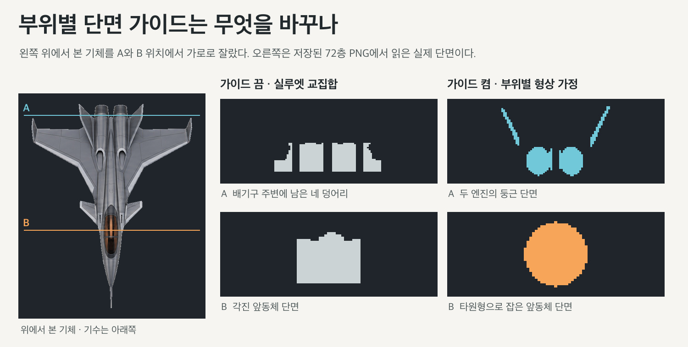
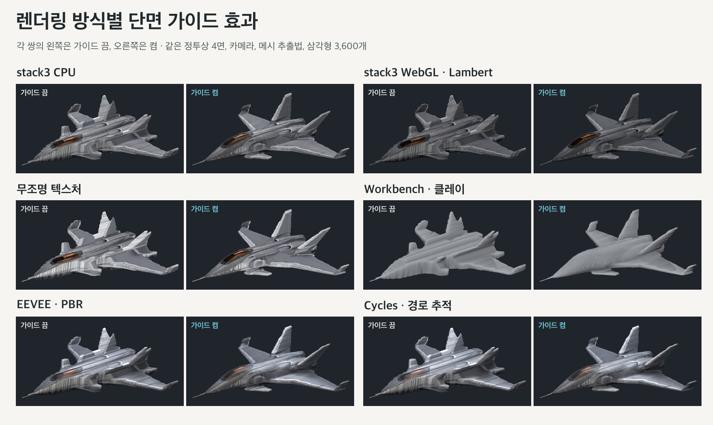

# 단면 가이드와 재질 조명 끔·켬

**단면 가이드**는 이 항공기에서 어느 위치까지 살을 채울지 정한 복원 규칙이다. 기본 방식은 정투상 4면의 실루엣에 모두 포함되는 셀을 채운다. 가이드를 쓸 때는 이미지에서 읽은 위치와 폭을 바탕으로 동체는 타원 단면, 후방 엔진은 둥근 단면 두 개, 날개는 두께가 변하는 얇은 판으로 지정했다. 꼬리날개는 뿌리에서 끝까지 위치를 보간했다. 이번 기체에 맞춰 코드로 직접 지정한 가정이다. 두 방식 모두 수평 72층 RGBA 스프라이트 스택을 거친다. [형상 규칙](../scripts/sections.py) · [기본 스택](../stack/stack.png) · [가이드 스택](../section-stack/stack.png)



A는 꼬리에서 기수로 세어 192줄 중 인덱스 10, B는 118이다. 각 위치의 좌우 두 그림은 같은 배율로 확대했다. A에서 기울어진 두 가는 조각은 꼬리날개를 가로지른 단면이다.

## 같은 렌더에서 형상만 바꾸기



기본 스택과 가이드 스택의 알파를 모두 128에서 이진화했다. 크기 151 × 192 × 72, 피벗, 표면 평활화와 Marching Cubes 임곗값, 주 연결 성분 선택, QEM 목표 **3,600삼각형**, 정투상 이미지의 텍스처 투영·베이크 규칙, 금속성·거칠기, 카메라를 같게 두었다. 재구성된 형상이 달라져 생성 UV와 베이크된 텍스처의 픽셀 배치는 달라진다. 이전 [전체 기법 비교](../README.md)와 이 표의 메싱 조건이 달라 수치도 다르다.

| 측정 | 가이드 끔 | 가이드 켬 |
| --- | ---: | ---: |
| 채워진 스택 셀 | 143,681 | 114,740 |
| EEVEE 사선 사진 실루엣 IoU | 70.93% | 72.65% |
| 입력 정투상 4면 평균 IoU | 88.68% | 77.64% |

사선 사진과의 겹침은 1.72%p 커졌고, 생성된 4면 입력과의 평균 겹침은 11.04%p 작아졌다. 사선 기준은 제공된 사진의 기체 마스크와 이전 실험에서 고정한 카메라다. 원본 3D 모델이 없어 실제 체적 정확도는 알 수 없다. [가이드 끔 GLB](models/guide-off.glb) · [가이드 켬 GLB](models/guide-on.glb) · [측정 JSON](results.json)

## 같은 형상에서 조명만 바꾸기

[메시 조명 끔·켬 캡처](captures/lighting.jpg) · [단면 방향과 CPU·WebGL 조명 캡처](captures/layers-by-lighting.jpg)

| 렌더러 | 조명 적용 전후 RGB 평균 차이 (0~255), 가이드 켠 메시 |
| --- | ---: |
| stack3 CPU | 23.47 |
| stack3 WebGL | 43.40 |
| EEVEE | 33.22 |
| Cycles | 34.03 |

각 엔진 내에서 동일한 모델과 텍스처를 썼다. 끔은 조명 계산을 우회해 텍스처 색을 출력한다. 켬은 CPU의 디테일 노멀·스펙큘러 AA를 포함하는 재질 조명, WebGL의 Lambert, EEVEE와 Cycles의 같은 Principled 재질과 스튜디오 조명이다. CPU의 4표본 서브픽셀 AA와 해상도 정책은 끔·켬 양쪽에 동일하게 적용했다. RGB 차이는 알파 254 이상인 공통 전경을 2픽셀 침식한 뒤 8비트 sRGB에서 측정했다. 네 엔진 모두 가이드를 켠 메시에서 조명 전후 전경 마스크 IoU는 100%였다. Workbench는 단색 형상 검사용이다.

스택 자체도 [방향 실험](../layer-axes/README.md)의 수평 72장, 두 수직 36+36장, 세 방향 각 24장을 CPU와 WebGL로 다시 촬영했다. 두 수직 단면을 정확히 위에서 보면 두 엔진 모두 조명 적용 여부에 관계없이 전경이 0픽셀이다. 사선에서 CPU 조명을 켜면 날개와 꼬리의 격자 명암이 두드러진다.

## 재현과 검증

저장소 루트에서 실행한다. 상위 실험의 [환경](../requirements.txt), 로컬 Blender, Chrome을 사용한다. Chromium WebGL은 SwiftShader 경로이므로 결과는 화질 비교에 사용했다. 비교판에서 CPU 프레임만 등록 카메라 크기로 리샘플링했고, 측정은 각 엔진 고유 해상도에서 수행했다.

```sh
exp="$PWD/docs/research/020-aircraft-rendering/guide-comparison"
work=$(mktemp -d)
uv venv "$work/env" --python 3.12
py="$work/env/bin/python"
uv pip install --python "$py" -r "$exp/../requirements.txt"
"$py" "$exp/build.py"
blender -b --factory-startup --python-exit-code 1 -P "$exp/blender_capture.py" -- "$work/frames"
# 저장소 루트에서 별도 터미널로 ./node_modules/.bin/vite --host 127.0.0.1 --port 4395 --strictPort 실행
"$py" "$exp/browser_capture.py" http://127.0.0.1:4395/docs/research/020-aircraft-rendering/guide-comparison/runtime.html "$work/frames"
"$py" "$exp/measure.py" "$work/frames"
"$py" "$exp/figures.py" "$work/frames"
```

두 GLB 모두 독립 glTF 검증에서 오류와 경고가 없었고, Blender로 다시 열어 렌더 검사를 통과했다. 각 모델에 면적이 0인 UV 삼각형 두 개가 있으며, 기존 카메라 좌표계에서 떠 있는 기체의 최저점이 바닥보다 높다는 경고가 남았다. [glTF 검사](gltf-validation.json) · [Blender 검사](blender-qa.json)
