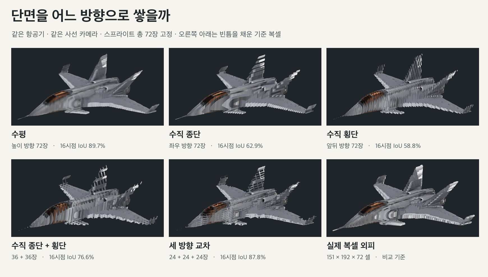

# 항공기 스프라이트 스택의 단면 방향

이 기체를 위에서 비스듬히 볼 때는 수평 단면이 날개를 연속적으로 보여준다. 수직 종단과 횡단을 겹치면 꼬리와 캐노피에서 격자 무늬가 드러난다. 정확히 위에서는 두 종류의 수직 단면이 모두 옆날로 보여 전경 픽셀이 0개다. 서로 다른 방향에서 기체를 돌려 보면서 이 빈 시점을 없애려면 수평과 두 수직 단면을 함께 쓸 수 있다.



[정면·측면·위 비교](captures/orthographic.jpg) · [수평+수직과 장수별 비교](captures/crossed.jpg) · [스택에서 메시로 전환한 캡처](captures/stack-to-mesh.jpg) · [앞선 항공기 실험](../README.md)

## 무엇을 고정했나

- 이전 실험의 [첨부 사진](../inputs/reference.jpg)에서 만든 [정투상 4면](../inputs/four-views.png)과 [부위별 단면 스택](../section-stack/stack.png)을 재사용했다. 같은 RGBA 격자 151 × 192 × 72에서 좌표만 바꿔 PNG 단면을 저장하고, 저장한 PNG를 다시 읽어 스택과 메시를 만들었다. 직교 방향을 추가해도 가려진 부위의 독립적인 관측 정보가 늘어나지는 않는다.
- 논리 좌표에서 X는 날개 폭, Y는 동체 길이, Z는 높이다. **수평**은 위아래로 쌓는 XY 평면, **수직 종단**은 기체를 좌우로 나누는 YZ 평면, **수직 횡단**은 기수를 향해 앞뒤로 쌓는 XZ 평면이다. 단면 위치는 등간격 목표에 가장 가까운 원본 셀 중심이다. 타일 좌표와 축별 위치는 [실험 설정](experiment.json)에 있다. 각 PNG와 JSON 번들은 로컬 좌표로 저장되며 뷰어가 해당 축의 월드 변환을 적용한다.
- 기준 복셀 외피는 원래 알파 128 이상의 셀에서 노출된 여섯 방향의 면을 stack3로 추출한 것이다. 크기, 피벗, RGB 원자료, 카메라를 고정했다. WebGL에서 무조명, 선형 스프라이트 필터, 알파 테스트 0.5와 MSAA를 사용했다. 각 축 조합은 지정된 슬라이스들을 깊이 테스트로 겹쳐 그린다. 한 장은 두께가 없는 양면 평면이다.
- 16시점은 고도 15°와 55°에서 방위각 0°부터 315°까지 45° 간격으로 촬영했다. 별도로 정확한 정면·측면·상면과 이전 실험의 사진 정합 카메라에서도 촬영했다. 16시점 평균은 각 화면의 전경 마스크와 같은 시점 복셀 외피 마스크 간 IoU의 산술평균이다. 원본 사진 IoU는 첨부 사진의 [기체 마스크](../inputs/reference-mask.png)와 비교한 별도 수치다. 두 수치는 다른 질문에 답한다.
- 메시 생성에서는 각 축에서 레이어 사이 알파를 선형으로 보간했다. 관측 평면의 값은 정확히 보존하고 나머지 위치는 가장 가까운 관측 단면까지의 물리적 거리 제곱에 반비례해 축별 값을 혼합했다. 외곽 샘플 너머는 가장 가까운 레이어 값을 연장했다. 동일한 128 임곗값과 기존 stack3 Marching Cubes를 적용했다. 3D IoU는 내보낸 GLB를 독립적인 VTK 스텐실로 다시 채워 원본 점유와 비교했다. 셀마다 3 × 3 × 3개 지점을 측정했다.

## 같은 총 장수

| 방식 | 장수 | 사선 16시점 스택 IoU | 스택 RGB 평균 절대차 / 255 | 사선 16시점 메시 IoU | 메시 3D IoU | 메시의 사진 IoU |
| --- | ---: | ---: | ---: | ---: | ---: | ---: |
| 수평 | 72 | 89.68% | 21.03 | 97.74% | 98.23% | 72.36% |
| 수직 종단 | 72 | 62.93% | 45.29 | 95.72% | 95.00% | 73.10% |
| 수직 횡단 | 72 | 58.76% | 47.60 | 96.13% | 96.98% | 72.26% |
| 두 수직 | 36+36 | 76.55% | 38.02 | 95.20% | 94.89% | 73.35% |
| 수평+종단 | 36+36 | 89.69% | 22.88 | 96.82% | 96.72% | 72.63% |
| 수평+횡단 | 36+36 | 88.34% | 24.50 | 97.09% | 97.30% | 72.52% |
| 세 방향 | 24+24+24 | 87.84% | 25.92 | 96.13% | 95.39% | 72.43% |
| 두 수직 | 72+72 | 86.08% | 26.74 | 96.95% | 97.43% | 72.64% |
| 세 방향 | 72+72+72 | 93.18% | 16.55 | 97.74% | 98.23% | 72.36% |

사선 위주의 고정 카메라에는 수평 72장이 실용적이다. 수평+종단 36+36장도 평균 실루엣이 거의 같으면서 정확한 측면을 보여준다. 세 방향을 각 24장씩 쓰면 16시점 평균은 87.84%로 낮아지지만 정면·측면·상면 모두 형상이 보인다. 두 수직만으로는 36+36장을 72+72장으로 늘려도 정확한 상면이 계속 비어 있다.

기본 체적이 원래 수평 72층에 저장되어 있어 수평 72장은 전체 알파를 관측한다. Z72와 세 방향 각 72장의 점유 격자 및 최종 GLB 바이트는 같았다. 수평 72장이 모든 에셋에서 우세하다는 근거로 일반화할 수 없는 조건이다. 단면에서 보이던 구멍이 메시화 후 메워져도 얇은 꼬리와 주날개의 요철은 남을 수 있다.

RGB 평균 절대차는 예측과 기준 외피 전경의 합집합에서 측정했다. 양쪽 이미지를 같은 어두운 회색에 합성하고 sRGB 채널 절대차를 평균한 뒤 16개 각도를 평균했다. 메시의 표면색은 공통 RGBA 소스에서 따왔으며 형상 평가와 별도다.

## 같은 텍셀 예산

수평 한 장은 151 × 192, 종단 한 장은 192 × 72, 횡단 한 장은 72 × 151텍셀이다. 같은 72장이라도 데이터량이 다르므로, 원본 전체 RGBA 텍셀 수의 절반인 1,043,712를 목표로 방향별 샘플 수를 반올림한 대조군도 촬영했다. 아래는 패딩과 PNG 압축 전의 실제 유효 타일 텍셀 수이며 저장 파일 크기나 실행 시간과는 다른 지표다.

| 방식 | 축별 장수 | 총 텍셀 | 사선 16시점 스택 IoU | RGB 평균 절대차 / 255 |
| --- | --- | ---: | ---: | ---: |
| 수평 | Z36 | 1,043,712 | 87.05% | 26.30 |
| 수직 종단 | X76 | 1,050,624 | 63.17% | 44.89 |
| 수직 횡단 | Y96 | 1,043,712 | 61.97% | 44.00 |
| 두 수직 | X38+Y48 | 1,047,168 | 77.91% | 36.20 |
| 수평+횡단 | Z18+Y48 | 1,043,712 | 82.87% | 31.39 |
| 수평+종단 | Z18+X38 | 1,047,168 | 83.64% | 30.46 |
| 세 방향 | X25+Y32+Z12 | 1,041,408 | 84.77% | 30.84 |

## 모델과 검증

[수평 72장 메시](models/z72.glb) · [두 수직 36+36장 메시](models/xy72.glb) · [세 방향 각 24장 메시](models/xyz72.glb) · [복셀 외피 GLB](models/voxel.glb) · [전체 메시 수치](mesh-results.json) · [시점별 측정값](view-results.json)

PNG 아틀라스마다 원본에서 선택한 단면을 바이트 단위로 대조했다. 복셀 외피를 되채웠을 때 3D IoU는 100%였다. 정확한 옆날 방향의 빈 캡처, 수평 72장과 세 방향 각 72장의 같은 메시 프레임도 검사했다. 모든 GLB를 Chromium의 Three.js GLTFLoader와 독립 메시 판독기로 다시 열었으며 Khronos glTF Validator 결과는 오류·경고 모두 0개다. [검증 기록](validation.json)

## 재현

저장소 루트에서 실행한다. 상위 실험의 [Python 의존성](../requirements.txt)과 Chrome, 저장소 npm 의존성을 사용한다. 모델링 캡처와 스코어는 Chromium이 WebGL로 실제 그린 프레임을 읽는다. 한글 비교판은 macOS Apple SD Gothic Neo 글꼴을 사용한다.

```sh
axis_dir="$PWD/docs/research/020-aircraft-rendering/layer-axes"
run_dir=$(mktemp -d)
uv venv "$run_dir/env" --python 3.12
py="$run_dir/env/bin/python"
uv pip install --python "$py" -r "$axis_dir/../requirements.txt"
"$py" "$axis_dir/prepare.py" "$run_dir"
./node_modules/.bin/tsx "$axis_dir/extract.mts" "$run_dir"
"$py" "$axis_dir/export.py" "$run_dir"

# 별도 터미널에서 저장소 루트의 서버 실행
# ./node_modules/.bin/vite --host 127.0.0.1 --port 4392 --strictPort
"$py" "$axis_dir/capture.py" http://127.0.0.1:4392/docs/research/020-aircraft-rendering/layer-axes/ "$run_dir/frames"
"$py" "$axis_dir/analyze.py" "$run_dir/frames"
"$py" "$axis_dir/figures.py" "$run_dir/frames"
```

같은 주소를 브라우저에서 열어 단면 조합과 스프라이트·메시·복셀 외피를 바꿀 수 있다. 드래그로 회전하고 카메라 메뉴에서 고정 시점으로 돌아간다.
