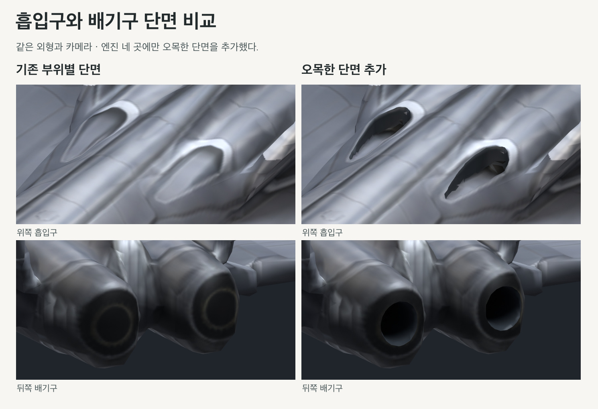

# 부위별 가이드로 엔진의 오목한 단면 복원

이전의 [3,600삼각형 가이드 모델](../guide-comparison/models/guide-on.glb)을 본체로 썼다. [등록된 TOP](../inputs/top.png)의 흡입구 안쪽 윤곽과 [REAR](../inputs/rear.png)의 배기구 고리를 기준으로, 각 입구의 경계와 안쪽 바닥을 지정했다. 입구 폭은 영상에서 읽고, 관측되지 않은 바닥 깊이와 테이퍼는 이 시제품의 시각적 가정으로 정했다. 이전 가이드 모델의 외부 재질과 날개 단면을 비교 기준으로 유지했다.



[개선 GLB](aircraft.glb) · [전체 기체](captures/aircraft.png) · [클레이 확대](captures/clay.jpg) · [지표](measurements.json)

## 만드는 방식

1. 원본 스프라이트 스택에서 만든 메시 위로 광선을 쏴, 흡입구를 그려 둔 두 위치의 기존 표면 높이를 읽는다.
2. 각 흡입구는 입술과 안쪽 바닥 사이를, 뒤쪽 두 배기구는 후면의 입구와 막힌 바닥 사이를 층별로 그린다. 고해상도는 그 부위에만 배정한다. 로컬 RGBA 스택은 86 × 175픽셀, 71층이며 알파 128 이상인 셀이 있는 층은 42개다. 알파는 비워낼 영역의 점유율이다. 로컬 원점과 간격은 별도로 기록한다. [스택 PNG](recess-stack/stack.png) · [스택 메타데이터](recess-stack/stack.json) · [배치](placement.json)
3. 저장한 PNG를 다시 읽어 Marching Cubes로 네 개의 닫힌 보조 표면을 추출한다. 이 볼륨들을 본체에서 빼고 기존 외피 노멀을 보간해 보존한다. 새 안쪽 면에만 윗면 텍스처, 후면 텍스처, 어두운 벽면 재질을 할당한다. [Blender Boolean Difference](https://docs.blender.org/manual/en/5.0/modeling/modifiers/generate/booleans.html)
4. 내보낸 GLB를 다시 열어 동일한 카메라와 조명으로 촬영한다. Cycles에서 재질 결과를, Workbench에서 입구 벽과 바닥을 확인한다.

## 결과와 한계

| 항목 | 기존 | 개선 |
| --- | ---: | ---: |
| 삼각형 | 3,600 | 4,998 |
| 사진 마스크와 사선 실루엣 IoU | 72.65% | 72.65% |
| 닫힌 연결 성분 | 1 | 1 |

위쪽 두 위치에서 수직으로 쏜 광선이 처음 닿는 면은 기존보다 각각 약 0.150, 0.149 장면 단위 안쪽에 있다. 뒤쪽 두 위치는 동체 길이 방향으로 약 0.266 단위다. 원래 격자로 환산하면 각각 높이 방향 약 6셀, 길이 방향 약 8.5셀이다. 사진 한 장으로 깊이의 절대 오차를 산출할 수는 없다. 사진 윤곽의 점수는 그대로인 반면, 사선으로 볼 때 먼쪽 벽이 가까운 테두리에 가려진다.

기존 주날개 단면 조건에 들어오는 삼각형 874개의 정점 위치를 장면 단위 소수점 여섯 자리로 비교했다. 모두 일치했다. 좌우 날개의 두께를 위·아래 교차점으로 잰 58곳에서도 최대 차이가 0이었다. 전체 메시의 열린 경계·분리 여부와 방향 일관성을 확인했다. Khronos Validator에서 오류와 경고는 0개다. Blender 렌더 QA는 통과했으며, 재임포트 메시의 중복 정점 287개, 원본에도 있는 면적 0 UV 두 개와 기체의 지면 높이 경고가 남았다. 기하 위치를 병합해 검사한 표면은 하나의 닫힌 성분이다. 같은 GLB를 실제 stack3 CPU 및 WebGL 미리보기로도 다시 렌더링했다. [glTF 검증](gltf-validation.json) · [Blender 검증](blender-qa.json)

## 재현

상위 실험의 Python 환경과 Blender 5.2.4를 사용한다. 이 폴더에서 실행한다.

```sh
work=$(mktemp -d)
python sections.py "$work"
blender -b --factory-startup --python-exit-code 1 -P build.py -- "$work"
blender -b --factory-startup --python-exit-code 1 -P capture.py -- "$work"
python measure.py "$work"
python figures.py "$work"
```
