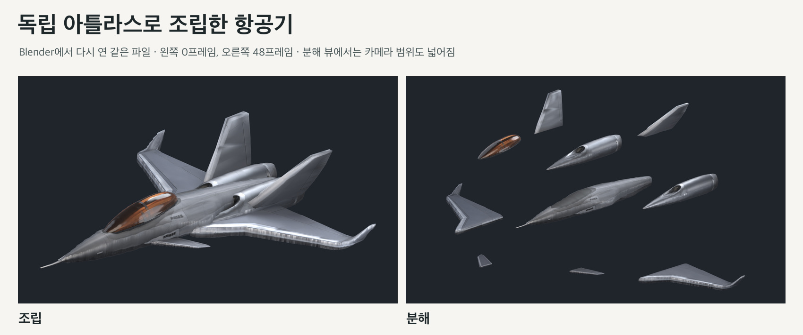
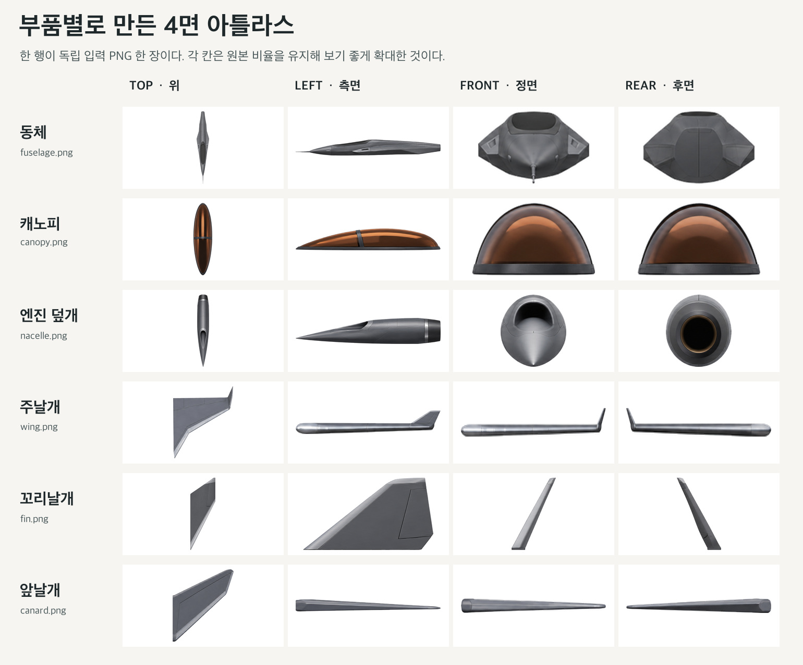

# 부품별 아틀라스에서 조립한 항공기

[Blender 파일](Aircraft.blend)을 열고 타임라인을 재생한다. 0프레임은 조립, 36~60프레임은 분해, 96프레임은 조립 복귀다. 이미지 에디터에서 `ATLAS ·`와 `STACK ·`으로 검색하면 각 부품의 입력과 스프라이트 스택이 보인다. 파일에 이미지 20개를 내장했다.



## 6개 이미지 입력

[원본 사진](../inputs/reference.jpg)과 [기체 전체 정투상도](../inputs/four-views.png)를 참조해 내장 ImageGen으로 서로 독립된 부품 4면도를 생성했다. 동체와 캐노피를 각각 한 번 사용하고 엔진 덮개·주날개·꼬리날개·앞날개는 좌우에 반전 배치하여 총 10개 노드로 조립했다. 각 부품의 메시 생성에는 해당 부품 아틀라스와 그 이미지에서 만든 스택만 사용한다. 이전 연구의 단일 기체 GLB는 형상 입력으로 쓰지 않는다.

[동체](atlases/fuselage.png) · [캐노피](atlases/canopy.png) · [엔진 덮개](atlases/nacelle.png) · [주날개](atlases/wing.png) · [꼬리날개](atlases/fin.png) · [앞날개](atlases/canard.png) · [입력 6장 ZIP](six-atlases.zip) · [생성 프롬프트](prompts.json)



생성된 패널마다 배율이 달라서 전체 정투상도에서 추정한 길이·폭·높이에 맞춰 축별로 등록했다. 꼬리날개의 첫 TOP은 뿌리의 긴 변이 가는 선으로 축소돼 측면과 맞지 않아서 새 TOP으로 교체했다. 기존 원본과 교체 이미지는 모두 보존했다. 주날개는 FRONT에서 얇은 날개판과 위로 꺾인 끝의 높이를 나누어 맞췄다. 가려진 장착면과 오목한 부분의 깊이에는 시각적 가정이 들어 있다. [생성 원본](originals) · [TOP 교체 프롬프트](fin-top-prompt.txt) · [등록값](calibration.json)

## 형상 및 재질

- stack3 코어로 각 아틀라스의 TOP·LEFT·FRONT·REAR를 읽어 스프라이트 스택을 만들었다. 동체와 엔진은 길이별 폭·높이로 둥근 단면을, 캐노피는 바닥이 평평한 돔 단면을 적용했다. 얇은 판은 양쪽 표면 경계를 부드럽게 이어 주었다.
- 엔진의 TOP에서 보이는 흡입구와 REAR의 배기구에는 스택 알파를 비워 안쪽 벽과 바닥을 만들었다. 최종 스택 PNG를 따로 저장한 뒤 다시 읽어 Marching Cubes와 QEM으로 여섯 메시를 추출했다. 색은 해당 부품의 4면만 투영했다. [스택 번들](stacks) · [개별 GLB](models) · [빌드 통계](build.json)
- 동체 표면 높이를 측정해 캐노피 기울기와 장착 높이를 맞췄다. 각 파츠에는 고유 변환이 있다. Blender에서는 같은 주요 형상에 캐노피·도장면의 거칠기 차이와 이번 주날개 TOP에 맞춘 패널 범프를 적용했다. [배치값](mounts.json)
- [GLB](aircraft.glb)는 가이드 적용 메시와 분해 클립의 교환용이다. [stack3 프로젝트](aircraft.stack3.json)는 6개 원본과 4개 좌우 반전본을 포함해 편집기에서 기본 실루엣 스택을 다시 구성한다. 추가 단면 가이드와 Blender 재질까지 포함한 최종 검수 파일은 위의 .blend다.

## 검증

6개 원본 부품 메시는 모두 닫힌 단일 성분이며, 조립 상태의 10개 파츠가 모두 동체까지 이어진다. 가려지는 마운트에는 소폭 겹침을 허용했다. 파일을 다시 열어 모든 노드의 정지·분해·복귀 변환을 확인하고 렌더했다. 개별 GLB 6개와 조립 GLB에 대한 Khronos 검증 결과는 오류와 경고 모두 0개다. Blender 재임포트 QA에는 일부 작은 UV 면적과 꼬리날개 근접 정점, 기준면 높이 경고가 남는다. [측정](measurements.json) · [glTF 검사](gltf-validation.json) · [Blender 검사](blender-qa.json)

기존에 등록한 동일한 사선 카메라에서 첨부 사진과의 실루엣 IoU는 **70.83%**다. 기존 단일 아틀라스의 가이드 적용본은 **72.65%**였다. 새로운 독립 입력으로 재구성한 결과여서 원본 형상과 차이가 있다. 주날개의 기존 측정 위치에서 새 메시의 두께는 **0.1271 장면 단위**, 이전 수치는 **0.1313**이다. Blender의 재질 마감은 정점 위치를 바꾸지 않는다.

## 재현

저장소 루트에서 상위 실험의 Python 환경과 Blender 5.2.4를 사용한다. `originals/`는 보존된 이미지 입력이다.

```sh
p=docs/research/020-aircraft-rendering/part-atlases
w=$(mktemp -d)
python "$p/prepare.py"
./node_modules/.bin/tsx "$p/stacks.mts" "$w"
python "$p/mesh_parts.py" "$w"
python "$p/assemble.py"
./node_modules/.bin/tsx "$p/project.mts"
blender -b --factory-startup --python-exit-code 1 -P "$p/capture.py" -- "$w"
python "$p/verify.py" "$w"
python "$p/finish_maps.py" "$w"
blender -b --factory-startup --python-exit-code 1 -P "$p/blender_scene.py" -- "$w"
blender -b "$p/Aircraft.blend" --python-exit-code 1 -P "$p/check_blend.py" -- "$w"
python "$p/plates.py" "$w"
```
