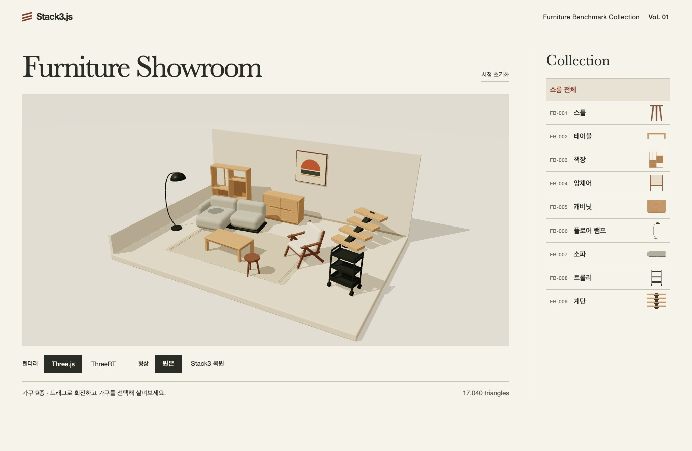
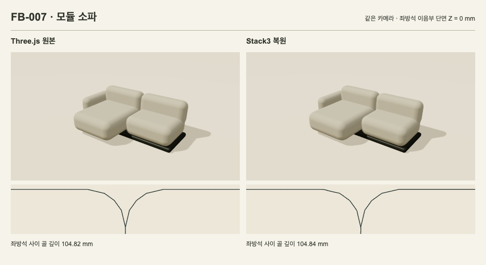
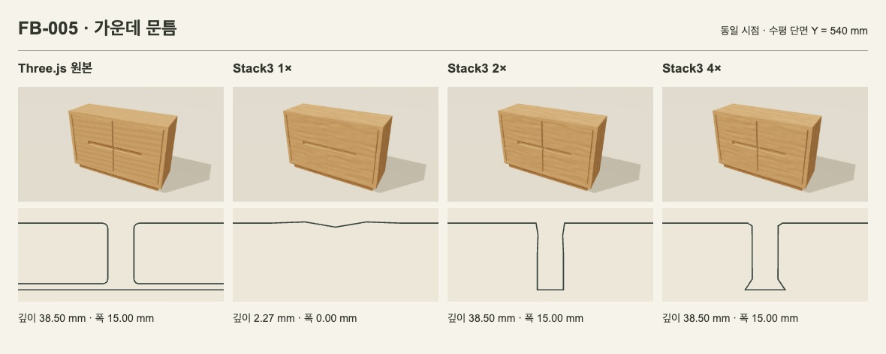

# Furniture Showroom

레퍼런스 사진에 보이는 형태를 바탕으로 직접 모델링한 모더니즘 가구 9종을 한 방에 배치했다. 렌더러와 형상을 독립적으로 선택할 수 있다. 같은 카메라로 Three.js에서 원본과 복원을 바꾸면 기하 차이를, 같은 GLB를 두 렌더러에서 열면 빛과 재질 표현 차이를 볼 수 있다.



## 실행

Node.js 22.12 이상에서 이 디렉터리에서 실행한다. 모델과 ThreeRT WASM이 프로젝트에 포함돼 있다.

```sh
npm ci
npm run dev
```

출력된 로컬 주소를 Chrome에서 연다. Three.js는 WebGL 2를 사용한다. ThreeRT의 WebGPU 경로는 localhost 또는 HTTPS와 WebGPU 어댑터가 필요하다. 열 수 없는 환경에서는 화면에 오류가 표시되며 Three.js 버튼으로 돌아갈 수 있다. 배포용 정적 파일은 `npm run build`, 로컬 확인은 `npm run preview`로 실행한다.

- 가구나 오른쪽 목록을 선택하면 개별 모델이 열린다. 쇼룸 전체 버튼으로 돌아간다.
- 드래그·방향키로 회전하고 휠·핀치로 확대한다. 렌더러 또는 형상을 바꾸면 URL에 카메라 위치와 타깃을 보존한다.
- 개별 화면에는 기준 폭 × 높이 × 깊이, 선택한 GLB의 삼각형 수, GLB 다운로드 링크가 있다. 테이블·책장·소파·캐비닛의 **단면 비교**에서 같은 평면으로 자른 두 윤곽과 측정값을 확인할 수 있다. 캐비닛의 형상 버튼은 **Three.js 원본**과 **Stack3** 두 가지다. 1×·2×·4×를 누르면 해당 해상도의 Triple-Dexel 메시로 전환된다. 같은 시점과 Y = 540 mm 단면에서 선택한 해상도를 원본에 겹쳐 볼 수 있다.

## 에셋과 측정

형상, 재질, 치수는 이 예제를 위해 설계했다. FB-001부터 차례로 원형 스툴, 낮은 오크 테이블, 비대칭 책장, 목재 프레임 암체어, 매입 손잡이 캐비닛, 아치형 램프, 모듈 소파, 3단 트롤리, 중앙 스트링거 계단이다. 목리와 직조 무늬는 수식으로 생성했다. 치수는 예제 설계값이며 상품 실측값은 별도로 수집하지 않았다.

쇼룸은 `reference.glb`와 Stack3 복원본을 같은 카메라로 표시한다. 캐비닛 이외 8종의 복원본은 `measured.glb`다. 이전 4뷰 실루엣 결과(`stack3.glb`)는 회귀 측정에 사용한다.

### 소파와 나머지 가구



각 원본 GLB의 부품 경계와 배치를 입력으로 사용한다. 소파의 좌방석 두 개, 등받이 두 개, 팔걸이, 받침을 각자 로컬 격자에 투영해 세 축의 진입·이탈 위치와 외향 법선을 측정한다. Stack3 Hermite DC로 각 부품을 복원한 뒤 원래 위치에서 조립한다. 쿠션 이음부가 다른 쿠션의 실루엣에 가려져도 각 단면이 유지된다. 소파는 부품의 긴 축을 96구간으로 샘플링한다. 복원 메시를 단순화하고 원본 원단·목재 재질을 다시 입힌다. 천 소재에는 원본 표면에서 보간한 셰이딩 법선을 적용한다. 원본의 부품 경계, 재질, 측정 깊이를 사용하는 조건이다.

램프 갓과 굽은 지지대는 셀 하나에 여러 표면이 나타난다. 같은 격자에서 메시까지의 부호 있는 거리를 측정하고 Stack3의 MC33으로 표면을 추출한다. 지지대는 부피 측정 시 끝 단면 두 곳을 닫는다. 스툴의 세 다리, 책장의 앞뒤가 열린 칸, 트롤리의 바퀴·프레임 등 나머지 부품은 Triple-Dexel 경로로 처리한다. 부품별 방식과 실제 삼각형 수는 `public/models/<id>/reconstruction.json`에 기록한다. [생성 코드](scripts/build-furniture-parts.py)

- 소파 중앙 수직 단면(Z = 0)에서 이음부 양옆 5 mm의 평균 높이와 양옆 200 mm의 좌면 높이를 비교했다. 골 깊이는 원본 **104.82 mm**, 이전 복원 **0.00 mm**, 새 복원 **104.84 mm**였다.
- 표면 비교는 고정된 여섯 사선 시점에서 각각 64 × 64 광선을 쏴 실루엣 IoU와 공통 적중 광선의 첫 표면 거리 오차 95백분위를 측정한다. 소파의 실루엣 IoU는 0.93408에서 0.99946으로, 거리 오차는 333.574 mm에서 0.520 mm로 개선됐다. 8종 모두 두 지표에서 개선됐다. [전체 측정값](public/models/surface-quality.json)
- 테이블 상판 중앙 77점의 기준 높이 RMS 오차는 원본과 새 복원 모두 0.000 mm였다. 책장의 지정 광선 세 개도 두 메시에서 모두 개구부를 통과했다. [단면과 국소 측정값](public/models/sections.json)

### 캐비닛 가운데 문틈



| 메시 | 격자 (폭 × 깊이 × 높이) | 가운데 깊이 | 폭 | 단면 평균 표면 오차 | 삼각형 |
| --- | --- | ---: | ---: | ---: | ---: |
| Three.js 원본 | — | 38.50 mm | 15.00 mm | — | 2,184 |
| Stack3 1× | 64 × 21 × 64 | 2.27 mm | 0.00 mm | 14.089 mm | 28,224 |
| Stack3 2× | 128 × 42 × 128 | 38.50 mm | 15.00 mm | 0.726 mm | 113,824 |
| Stack3 4× | 256 × 84 × 256 | 38.50 mm | 15.00 mm | 0.085 mm | 462,316 |

세 단계 모두 동일한 원본 GLB와 바운딩 박스를 사용한다. 각 축을 배수만큼 세분화하고 새 셀 중심을 지나는 광선을 다시 쏴 깊이 교차점과 외향 법선을 기록한다. 부품별 진입·이탈 구간은 합집합으로 처리한다. 세 축에서 계산한 점유가 일치할 때 그 점유와 측정값을 Stack3 Hermite DC에 입력한다. RGB는 기존 색상 샘플을 확대해 공유한다. [생성 코드](scripts/build-cabinet-dexel.py) · [내보낸 메시의 측정값과 단면](public/models/sections.json)

- **깊이**는 높이 540 mm에서 문틈 중앙(X = 0)과 평평한 문짝(X = 160 mm)의 전면 깊이 차이다.
- **폭**은 문 표면에서 원본 깊이의 절반인 19.25 mm 안으로 들어가 좌우 벽 사이를 잰 값이다. 1×는 이 깊이에 도달하지 않아 0.00 mm다.
- **단면 평균 표면 오차**는 중앙 40 mm 구간을 0.1 mm 간격으로 나눈 400곳에서 원본과 복원본의 전면 위치 차이를 절댓값으로 평균한 것이다. 2×와 4×의 깊이와 폭은 0.01 mm 표시 정밀도에서 같고, 4×가 모서리 윤곽을 더 가깝게 재현한다.

원본과 복원을 재생성할 때는 저장소 루트의 `npm ci`도 먼저 실행한다. 다음 명령은 예제 디렉터리에서 실행한다.

```sh
# 원본·4뷰·Triple-Dexel과 측정값을 모두 재생성 (Node.js와 uv 필요)
npm run build:assets

# 기존 원본에서 소파 등 8종의 부품별 복원과 측정값을 다시 생성
npm run build:furniture-parts

# 기존 원본에서 캐비닛 1×·2×·4×와 측정값만 다시 생성
npm run build:cabinet-dexel
```

측정기는 Python과 trimesh로 내보낸 GLB 28개를 다시 열어 삼각형 수와 치수를 검사하고, 지정 위치에 광선을 쏴 표의 값을 산출한다. 수평 단면은 같은 GLB의 삼각형과 평면의 교차선이다. 렌더러별 조명·노출과 내부 렌더 해상도가 다르므로 이 화면은 GPU 성능 순위를 산출하지 않는다.

## ThreeRT 런타임

`@threert/scene` 0.1.1과 MIT 라이선스의 [ThreeRT 소스](https://github.com/meshy-dev/ThreeRT/tree/1aae0b7f81a5ba6a4491bc624baf4a5799ffb060)를 사용한다. `vendor/engine.ts`는 해당 리비전의 웹 어댑터다. 번들한 JS·WASM은 같은 리비전에 `vendor/adaptive-quality.patch`를 적용한 로컬 빌드다. 라이선스는 `public/threert/LICENSE`에 있다. 브라우저 경로는 WebGPU에서 광선을 추적하며 정지 카메라는 최대 64프레임을 누적한다.

런타임을 재빌드하려면 해당 리비전에 패치를 적용한 뒤 `cargo build --manifest-path renderer/web/Cargo.toml --target wasm32-unknown-unknown --release --locked`를 실행한다. 생성된 `threert_web.wasm`에 wasm-bindgen CLI 0.2.130의 `--target web`을 사용한다. 이 예제에 포함된 WASM의 SHA-256은 `9cb5669d0512336cd066557c5211d64e78a786524f4d022a495aba33f17ca49d`이다.
