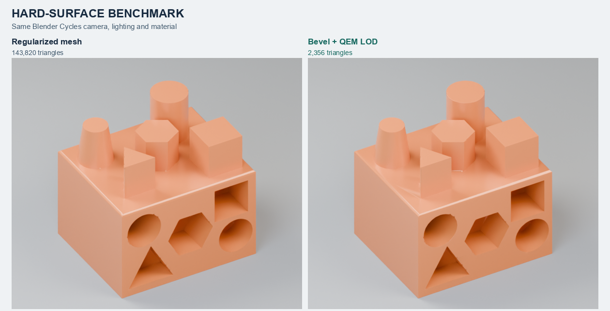

# Hard-surface benchmark

The authored fixture models a 60 × 50 × 40 mm base, five protrusions, and five front openings. The upper-left circular opening is a through-hole. The other four pockets have authored depths of 10, 14, 15, and 12 mm. These depth and through-hole choices define the benchmark.

## Run

From the repository root, with the stack3 checkout dependencies, uv or `STACK3_PYTHON`, and Blender installed:

```sh
npm run cli -- pipeline run examples/hard-surface-benchmark/lod-bevel.pipeline.yaml
```

Use `BLENDER_BIN` to select a Blender executable when needed. The [recipe](lod-bevel.pipeline.yaml) reads the example's own prepared [stack](inputs/stack/stack.json) and [Triple-Dexel guide](inputs/dexel.guide.json). The [fixture](inputs/fixture.json) records the design dimensions for verification.

1. Extract with Hermite DC using the registered Triple-Dexel crossings and normals.
2. Regularize the selected faces, bore and protrusion rims.
3. Run QEM to `preTriangleBudget: 1900`.
4. Apply a 0.15 mm, two-segment bevel to the through-bore and cylindrical-post rims. The recipe uses scene units with 60 mm per unit.
5. Check closed topology and the 2,400-triangle final budget, then write `out/lod.glb`.

## Verify

```sh
blender --background --factory-startup --python-exit-code 1 \
  --python examples/hard-surface-benchmark/verify.py -- \
  examples/hard-surface-benchmark/out/lod.glb
```

Pass a second path after the GLB path to save a JSON report. The verifier imports the GLB, welds coincident positions for topology checks, counts raised footprint regions, and ray-casts the five apertures. It checks a 0.1 mm center-depth and height tolerance and a minimum opening IoU of 0.97 for this fixture.

The [verified LOD](references/lod.glb) has **2,356 triangles**, five openings and five raised regions. The through-hole stays open, the pocket center depths match the authored values within the benchmark tolerance, and Blender found zero open edges, non-manifold edges, inconsistent edges or zero-area triangles. [Verification report](references/verification.json)

## Reference images

- [Dimensioned source drawing](references/reference-drawing.png)
- [Four-view RGB draft](references/benchmark-4view.png), [atlas review overlay](references/atlas-review.png), and [atlas verification manifest](references/benchmark.atlas.yaml)
- [Triple-Dexel depth layers](references/triple-dexel.png) and [RGB visual hull versus Triple-Dexel comparison](references/triple-dexel-comparison.png)
- [Regularization detail](references/regularization-detail.png) and [4.5 mm rim crops](references/lod-rims.png)

The RGB atlas and its review describe a visual reference with registration differences. The measured-input recipe uses the authored benchmark stack and Triple-Dexel data.


