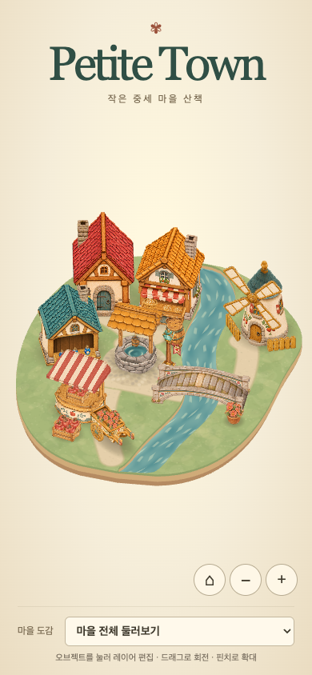

# Petite Town

사람 캐릭터가 없는 중세 판타지 장난감 마을이다. 중앙 우물에서 돌다리를 건너면 풍차가 있고, 시장 진열대에는 빵과 사과, 포션 병이 놓여 있다. 두레박 아래에는 청록색 잔물결이 번지고, 개울의 물빛은 굽은 둑을 따라 풍차 쪽에서 돌다리 아래로 흐른다. 두 수면은 Three.js 셰이더로 그리며 기기의 동작 줄이기 설정을 따른다. 하단 도감에서 품목을 고르면 다른 건물이 가리지 않는 상태로 한 바퀴 살펴볼 수 있다.



## 다운로드해서 실행

[단일 HTML 다운로드](https://raw.githubusercontent.com/ev3rlit/stack3.js/main/examples/petite-town/standalone/index.html) · [Windows·macOS 한 줄 실행 명령](../../README.md#download-and-play)

파일을 기본 브라우저로 열면 마을이 로드된다. 드래그로 회전하고, 휠 또는 두 손가락으로 확대한다.

## 레이어 편집

마을에서 오브젝트를 클릭하거나 탭하면 부품 편집 창이 열린다. 부품을 선택하고 수직 레이어 수(8~128)를 조절한 뒤 **적용**을 누른다. 같은 상자 안에서도 사과 하나만 따로 바꿀 수 있다. **기본값 복원**은 선택한 부품만 초기화한다. 도감으로 오브젝트를 고른 뒤 **레이어 편집** 버튼을 이용해도 된다. 변경값은 현재 브라우저의 로컬 저장소에 보관한다.

처음 보는 아틀라스와 설정 조합은 Web Worker에서 Marching Cubes로 재구성한다. 같은 조합의 진행 중인 빌드와 완성 메시는 공유하며, 화면에 배치된 같은 메시와 재질은 Three.js의 `InstancedMesh`로 함께 그린다. 한 인스턴스의 레이어를 변경하면 해당 인스턴스만 새 그룹으로 이동한다. 레이어 수는 메시를 생성할 때 쓰는 높이 방향 샘플 수다.

HTTPS 또는 localhost에서는 아틀라스 SHA-256, 빌더 버전, 모델 ID, 수평 해상도, 레이어, 프로필을 키로 완성 GLB를 Cache Storage에 저장한다. 최대 64개를 보관한다. 브라우저 저장소를 사용할 수 없을 때도 현재 세션에서 같은 메시를 재사용한다. [편집 화면](verification/layer-editor.jpg) · [기본 설정](src/model-settings.ts)

## 에셋과 조립

`atlases/<id>.png`와 `models/<id>.glb`는 같은 ID로 짝을 이룬다. 도감에서 목조 주택을 고르면 본체와 여섯 부품이 한 집으로 표시된다.

| 완성 품목 ID | 앱에 배치한 부품 |
| --- | --- |
| `house` 목조 주택 | 다락 창이 있는 본체 `house`, [빨간 지붕](atlases/house-roof.png), 현관문 `house-door`, 현관등 `house-lantern`, 좌우 측벽의 `house-window-flowers`와 `house-window`, 지붕 왼쪽 뒤의 [돌굴뚝](atlases/house-chimney.png). [조립 모습](verification/house-assembly.jpg) |
| `bakery` 빵집 | 수평 용마루와 줄무늬 차양이 있는 [본체](atlases/bakery-shell.png), [돌굴뚝](atlases/bakery-chimney.png), 정면·측면의 [꽃창](atlases/bakery-window.png) 2개, [매대](atlases/bakery-counter.png), 바구니, 빵 3개, 간판. [조립 모습](verification/bakery-assembly.jpg) · [지붕 높이와 접합 측정](verification/bakery-assembly.json) |
| `potionist` 포션가게 | `potion-shell`, 석조 굴뚝 `potion-chimney`, 목제 매대 `potion-counter`, `bottle` 3개, `potion-sign`, 앞·뒤·측면의 `potion-window` 3개와 측벽을 타고 오르는 `potion-ivy` 4개. [조립 후 네 방향](verification/potion-assembly.jpg) |
| `well` 돌우물 | `stone-ring`, `water`, `post` 2개, `well-roof`, `rope`, `pail` |
| `apple-crate` 사과 상자 | 빈 `crate`와 `apple` 5개 |
| `apple-stall` 사과 판매대 | `stall-frame`, `awning`, 같은 상자와 사과 5개 |
| `barrel` 오크통 | 단일 GLB. 우물 두레박은 자체 모델을 사용 |
| `flower-cart` 꽃 수레 | `cart-body`, 주차 받침을 잇는 `post`, `wheel` 2개, `flower` 3포기 |
| `planter` 화분 | 빈 `pot`과 수레에서 사용한 `flower` 1포기 |
| `lamp` 수정 가로등 | `lamp-post`와 `flag` |
| `bridge` 돌다리 | 별도 교각이 없는 한 겹의 곡면 보행판 [bridge-arch](atlases/bridge-arch.png) 1개와 [bridge-side-frame](atlases/bridge-side-frame.png) 2개. 같은 프레임을 반대편에 180° 돌려 장착 |
| `windmill` 풍차 | `mill-body`, 수평으로 놓은 목재 축 `post`, 허브 중심에서 회전하는 `rotor`, `fence` 2개 |

[조립 배치표](src/assemblies.ts)에 부품별 목표 폭·높이·깊이, 로컬 위치, 회전, 인스턴스 수를 기록했다. 단위는 m이며 Three.js의 Y축이 위다. 부품은 실제 GLB 바운딩 박스의 바닥 중앙을 기준으로 장착한다. 풍차 날개는 허브 중심을 기준으로 로컬 Z축을 회전한다. [장면 행렬](verification/scene-matrices.json)은 브라우저가 불러온 72개 인스턴스의 월드 변환값이다.

## 파일 수와 제작 과정

| 경로 | 수량과 용도 |
| --- | --- |
| [originals](originals/) 바로 아래 | 생성 원본, 보정 후보와 원본에서 추출한 부품 PNG 101장 |
| [originals/guides](originals/guides/) | 재생성 입력에 사용한 윤곽 가이드 PNG 14장 |
| [atlases](atlases/) | 최종 투명 4뷰 PNG 54장. 완성 품목 12종과 프롭 42종 |
| [models](models/) | 내보낸 stack3 GLB 54개. 기본 마을에는 고유 부품 43종을 배치 |
| [verification](verification/) | 브라우저 캡처 PNG 2장, 품목별 회전·조립 검수와 편집 창 캡처, 검수 데이터 |

납품 디렉터리의 PNG는 원본·가이드·최종본·검수 화면을 합쳐 171장이다. 의존성 폴더와 배포 사본은 이 수량에서 제외했다.

[생성 기록](originals/generation.json)에 각 원본의 실제 ImageGen 프롬프트, 참조 이미지와 SHA-256을 담았다. 모든 최초 4뷰는 저장소 스킬의 **Generate the four views**로 생성했다. TOP 교정에는 **Replace a tilted TOP** 프롬프트에 대상별 랜드마크를 넣고, 채택한 LEFT·FRONT·REAR를 참조로 첨부했다. 지붕과 얇은 부품의 후속 시도에는 평면 윤곽 가이드도 첨부했다. 모든 납품 뷰의 그림은 ImageGen 원본에서 왔다.

천막 줄무늬는 앞뒤 방향으로 이어지며, 측면 천은 바깥쪽 줄과 같은 딸기색 단색이다. 천막의 TOP·LEFT와 주택 랜턴의 LEFT를 개별 재생성해 윗면, 레이스, 리벳 고정판의 정투영을 교정했다. [현재 판매대 측면](verification/awning-side.jpg) · [단색화 전 정투영 교정 과정](verification/awning-lantern-views.jpg)

[뷰 치수 기록](verification/view-dimensions.json)에 채택한 TOP 파일명, 원본 패널 크기, 패널별 균일 배율, 최종 크기와 기준선이 있다. 빵집·판매대 등의 LEFT는 돌출 카운터나 낮은 앞처마가 화면 왼쪽을 향하도록 좌우를 맞췄다. 돌다리는 세로로 뻗은 TOP을 기준으로 좁은 입구를 FRONT, 긴 아치 면을 LEFT로 삼았다. 앱의 돌다리는 보행판과 얇은 측면 프레임을 개별 재구성해 조립한다. TOP의 양 가장자리는 평행하며, LEFT에서는 중앙으로 갈수록 높아진다. 보행판 윗면에는 재구성한 정점 높이에 따라 명암을 입혔다. 아치 밑의 석축과 양끝 교각은 프레임이 담당한다. 기본 조립본은 두 프레임과 보행판을 공통 1,500픽셀 경간에 투영해 개구부 침범 여부를 검사한다. 8~128층을 각각 재구성한 14,641가지 보행판·프레임 레이어 조합에서도 두 측면 모두 돌출 픽셀이 0개였다. 기존 일체형 `bridge.png`와 `bridge.glb`는 이전 형태의 참조 파일이다. [조립 후 세 방향](verification/bridge-assembly.jpg)

## 재구성

Node.js와 `npm ci`로 준비한 의존성만 사용한다. 아래 두 명령은 제작용 PNG와 GLB를 디스크에 내보낸다. 런타임 편집과 모델 내보내기는 같은 [TypeScript 재구성 함수](src/build-model.ts)를 호출한다. [아틀라스 준비](scripts/prepare-atlases.ts)는 승인 뷰 선택, 정렬, 균일 리사이즈와 투명 여백을 처리한다.

```sh
npm run build:atlases
npm run build:models

# 특정 부품만 다시 내보내기
npm run build:atlases -- bridge-arch
npm run build:models -- bridge-arch
```

[동봉한 코어](vendor/stack3-core-0.1.0.tgz)는 이 저장소의 `packages/core`를 `npm pack`한 패키지다. 품목별 수평 해상도는 48 또는 64, 수직 샘플 수는 32 또는 44다. [모델별 설정과 결과](verification/models.json)에 각 뷰의 치수, 회전 대칭 프로필, 삼각형 수, 파일 크기, 검사 경고가 있다. 얕은 바구니·화분·사과 상자는 가려진 내부 깊이를 살리기 위해 기존 윗면 정점을 안쪽으로 낮췄다. 일부 건물·지붕·천막은 경사면에 승인된 TOP을 재투영해 정면 무늬가 지붕에 반복되는 현상을 줄였다. 이 후처리들은 재구성 스크립트에 포함되어 있다.

## 검수 결과와 한계

- 54개 아틀라스를 stack3의 `inspectViews`로 검사했고 비율 경고는 0건이었다. TOP은 원본 크기에서 지붕 마루와 굴뚝, 처마와 네 귀퉁이, 우물의 원형 입구, 다리 난간과 풍차 축 방향을 입면과 대조했다.
- Khronos glTF Validator로 54개 모델을 독립 검사해 오류 0건·경고 0건을 확인했다. [glTF 검증 기록](verification/gltf-validation.json)
- 실제 Chrome에서 1280×900 데스크톱의 580×846 세로 프레임과 390×844 모바일 뷰포트를 검사했다. 12종을 모두 로딩하고, 마우스 드래그로 각 품목을 한 바퀴 회전했다. 휠 확대, 한 손가락 회전, 두 손가락 확대, 전경 복귀와 풍차 회전을 확인했다. 모바일 입력은 Chrome 터치 에뮬레이션에서 실행했다. [브라우저 측정값](verification/browser.json) · [회전 캡처 48컷](verification/orbit-review.jpg)
- GLB에 직접 광선을 쏴 우물 중앙 구멍과 물 표면, 다리 양쪽 받침과 아치 개구부, 바퀴살 사이의 빈 공간을 확인했다. 바구니·화분·빈 상자 모두 중앙 바닥이 테두리보다 낮았다. 장면 행렬을 적용한 12종의 최저점은 지면 Y=0이었고, 지면 부근에서 샘플링한 정점은 모두 둑 위에 있었다. [형상·접합 측정값](verification/geometry.json)
- 네 방향 실루엣으로 복원하면서 꽃잎·잎사귀는 일부 덩어리로 이어지고, 가까이 확대하면 굴뚝과 얇은 목재의 윤곽에 계단과 투영 경계가 보인다. 바구니·화분·상자의 실제 안쪽 깊이는 이미지에 보이지 않아 조정값을 사용했다. 원형·대칭 소품의 정면 방위는 이미지 자체만으로 유일하게 판별하기 어렵다. 실기기 GPU 성능과 모바일 Safari는 측정하지 않았다.

동일한 브라우저·형상 검사를 다시 실행하려면 Google Chrome과 Python 패키지 `playwright pillow numpy scipy trimesh rtree`를 설치하고, 미리보기 서버가 실행된 상태에서 다음을 실행한다.

```sh
python3 scripts/check-browser.py http://127.0.0.1:4173/
python3 scripts/check-geometry.py
```

## 소스에서 실행

Node.js 22.12 이상에서 이 폴더만으로 실행할 수 있다. 브라우저는 로컬 4뷰 PNG로 stack3 메시를 만들고 Three.js로 그린다. 필요한 stack3 코어 패키지도 이 예제에 동봉했다.

```sh
cd examples/petite-town
npm ci
npm run dev
```

개발 서버가 출력한 주소를 연다. 같은 Wi-Fi의 휴대전화에서는 `npm run dev -- --host 0.0.0.0`으로 실행하고 출력된 Network 주소를 연다. 마우스로 드래그하거나 한 손가락으로 쓸어 회전한다. 휠, 두 손가락 핀치, 화면의 +/− 버튼으로 확대·축소한다. 집 모양 버튼은 마을 전경으로 돌아간다. 캔버스에 키보드 초점을 두면 좌우 방향키와 +/− 키도 쓸 수 있다.

```sh
npm run build
npm run preview
```

빌드 결과는 `dist/`다. 이 폴더를 정적 HTTP 서버에 그대로 올리거나 `python3 -m http.server 4173 --directory dist`로 열 수 있다. 배포와 실행에 Stack3 Playground나 stack3 CLI 서버는 필요하지 않다.

단일 파일을 다시 만들려면 이 예제 폴더에서 `npm run build:standalone`을 실행한다. 결과물은 `standalone/index.html`이다.
