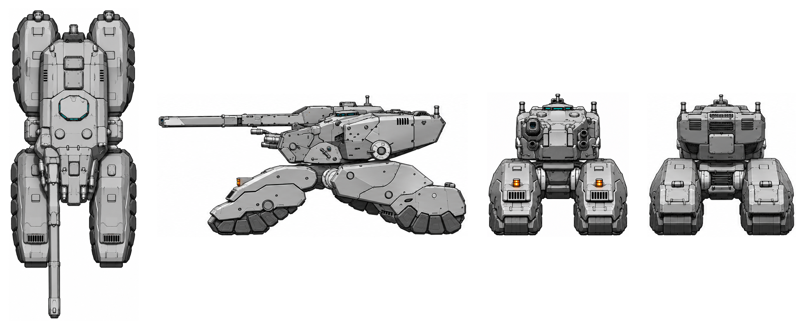
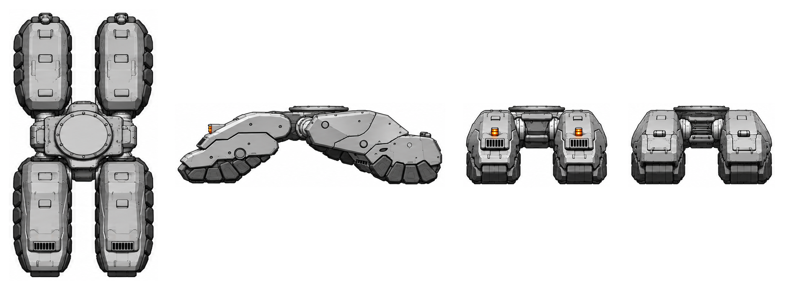
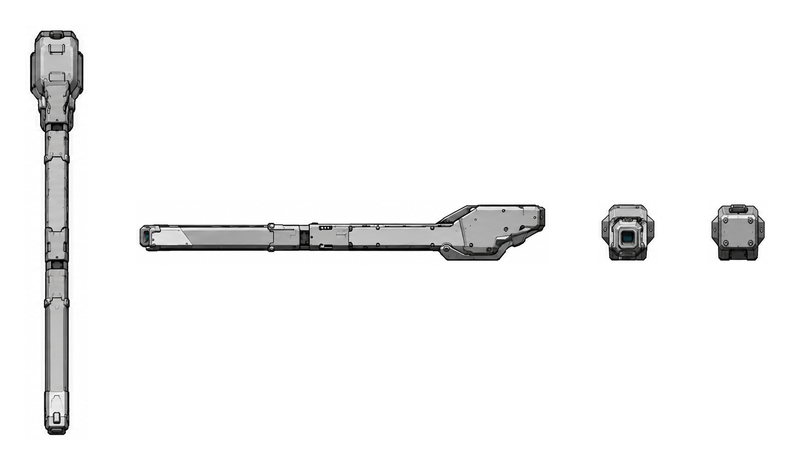

# Future Tank

After [installing the CLI](../../apps/cli/README.md#installation), copy the example into your working directory and open it.

```sh
stack3 example future-tank
stack3 project open future-tank.stack3.json --playground
```

Press **Play**. Use **A/D** to turn the chassis and **Q/E** to turn the turret and barrel. Open **4-view comparison** from the project toolbar to see the reconstruction gallery. The **Layers**, **Spacing**, and **Explode** controls adjust the previews.


[Assembled Playground view](../../docs/media/future-tank-playground.png) · [Sprite stack turntable](../../docs/media/future-tank-stack-turntable.gif) · [Mesh turntable](../../docs/media/future-tank-mesh-turntable.gif) · [Exploded turntable](../../docs/media/future-tank-exploded-turntable.gif)

## Four-view atlases



The project embeds the hull, turret, and barrel as separate four-view atlases. Each source PNG uses TOP, LEFT, FRONT, REAR order. The complete vehicle sheet, [future-tank-4view.png](future-tank-4view.png), is a reference for the original composition.

| Lower chassis | Turret | Barrel and mount |
| --- | --- | --- |
| [](hull-4view.png) | [](turret-4view.png) | [](barrel-4view.png) |


## Hull material passes

In **4-view comparison**, choose **Future Tank · hull material passes**. The first row compares Clay silhouettes with and without the calibrated depth pass, using the same grid and lighting. Depth Fit reports mean absolute error on rays visible in both meshes against the supplied depth atlas. The color and normal cards use the same depth-carved mesh. The right side reuses a mirrored left view.

| Pass | Image |
| --- | --- |
| Clay | [Clay 4-view](hull-clay-4view.png) |
| Depth | [16-bit depth map](hull-depth-4view.png) |
| Base Color | [Color atlas](hull-base-color-4view.png) |
| Normal | [View-space normal atlas](hull-normal-4view.png) |

[Camera registration and encodings](hull-depth-4view.json)
