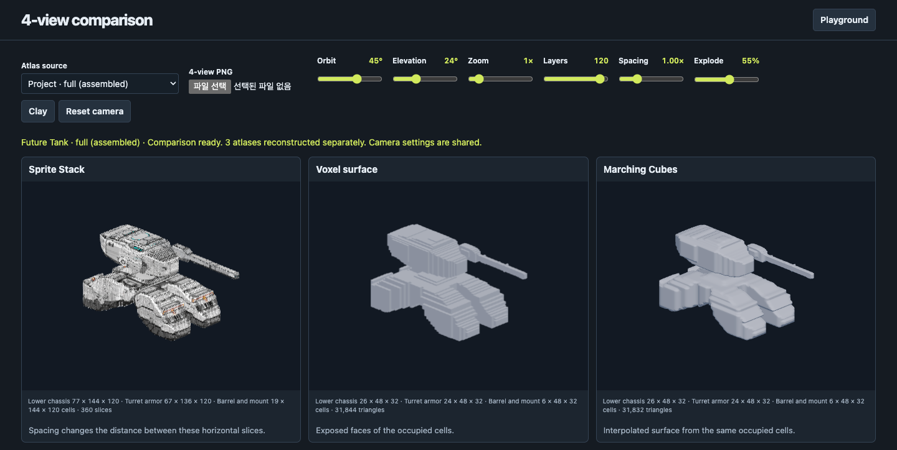
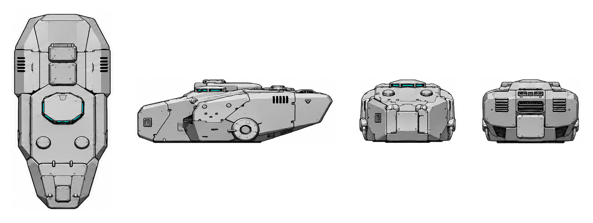

# Future Tank

After [installing the CLI](../../apps/cli/README.md#installation), copy the example into your working directory and open it.

```sh
stack3 example future-tank
stack3 project open future-tank.stack3.json --playground
```

Press **Play**. Use **A/D** to turn the chassis and **Q/E** to turn the turret and barrel. Open **4-view comparison** from the project toolbar to see the reconstruction gallery. The **Layers**, **Spacing**, and **Explode** controls adjust the previews.



## Four-view atlases


The project embeds the hull, turret, and barrel as separate four-view atlases. Each source PNG uses TOP, LEFT, FRONT, REAR order. The complete vehicle sheet, [future-tank-4view.png](future-tank-4view.png), is a reference for the original composition.

| Lower chassis | Turret | Barrel and mount |
| --- | --- | --- |
| [](hull-4view.png) | [](turret-4view.png) | [](barrel-4view.png) |
