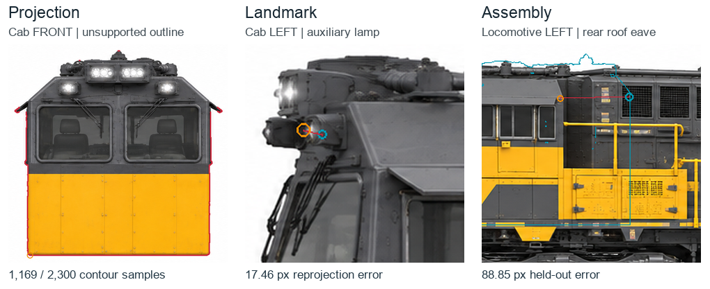

# 기관차 운전실 4면도 검증

[사용자 원본](reference.png)은 기관차 앞쪽과 한쪽 측면이 보이는 사선 이미지다. 노란 단비부와 난간, 회색 운전실, 전면 창과 등화 배치는 원본에서 볼 수 있다. 운전실의 후면과 장착면은 이 사진에서 판별할 수 없다. 내장 ImageGen으로 [기관차 전체](locomotive.png)와 [분리한 운전실](cab.png)의 4면도를 각각 생성했다. 운전실 아틀라스에 나타난 후면 창·통풍구는 추정이다. 두 생성 이미지의 합치도를 실물 치수의 정확도로 해석할 수 없다.

**검사 입력은 보정 전 생성 PNG**다. 매니페스트에서 패널 영역만 잘랐으며 이미지를 변형하지 않았다. 흰 배경 마스크의 임계값은 195다. 좌표는 패널 왼쪽 위 픽셀 중심 기준이다. 운전실은 중심선·뒤쪽 지붕 기준 위치·하단을 원점으로 잡고 네 뷰에서 명목상 같은 배율을 사용했다. 전체 기관차 TOP과 LEFT는 생성 시 서로 다른 배율이어서 전장을 기준으로 TOP의 단일 배율을 0.545로 잡았다. FRONT와 REAR는 LEFT와 명목상 같은 배율을 가정했다. 기준점과 배율은 수작업 추정이며 오차에 포함된다. 허용값은 이 사례에서 선택한 6px다. 알파 또는 배경 분할로 해당 스캔라인 전체가 비어 있으면 비교 가능한 구간이 없어 허용값과 별개로 기록한다.

저장소 루트에서 다음 명령으로 재현한다. 검증에는 uv 또는 의존성이 설치된 STACK3_PYTHON이 필요하다.

```sh
p=samples/inspection/locomotive-verify
node apps/cli/bin/stack3.mjs verify -f "$p/locomotive.assembly.yaml" > "$p/qa/report.json"
```

[전체 기관차·운전실·가조립 측정 JSON](qa/report.json)에서 측정값을 함께 볼 수 있다. 같은 명령에 `--output-dir qa`를 추가하면 오버레이도 저장한다.

| 검사 | 결과 | 근거 |
| --- | --- | --- |
| 투영선 | TOP 429/2,112, LEFT 611/2,214, FRONT 1,169/2,300, REAR 478/1,778 경계 표본이 다른 뷰와 모순. 총 2,687/8,404(32.0%). 전면에서 예시로 표시한 하단점의 대응 높이에는 LEFT 점유 구간이 없다. | [오버레이](qa/projections/projections.png) · [모든 연속 구간과 스캔라인](qa/projections/report.json) |
| 특징점 | 보이는 바깥쪽 전면 보조등을 수동 지시했다. TOP과 FRONT의 공유 x 오차는 5px. LEFT 예측 (93, 103)과 관측 (110, 107)의 거리는 17.46px. REAR에서 등 중심은 가려진다. | [오버레이](qa/landmarks/landmarks.png) · [입력 쌍별 측정](qa/landmarks/report.json) |
| 가조립 | TOP 지붕 양끝 두 점과 FRONT 등 높이로 맞췄다. FRONT 장착점에는 가로 오차 8.01px가 남았다. 재정렬 없이 LEFT 지붕 처마 끝은 88.85px, FRONT 표시 지붕 가장자리의 최대 거리는 8.60px. 후방 장착부는 가림으로 제외했다. | [오버레이](qa/assembly/assembly-1.png) · [변환과 측정](qa/assembly/report.json) |



정답이 있는 [CLI 대조 실험](../../../apps/cli/test/verify.test.ts)은 정상 투영에서 오류 0건을 확인하고, FRONT 윙팁 변경에서 7px 구간 간격, LEFT 특징점 이동에서 4px 재투영 오차, TOP 장착점 이동에서 3px의 독립 LEFT 오차를 검사한다. 입력의 숨겨진 뷰와 정렬 정보 누락도 확인한다.

## 아틀라스 생성 프롬프트

두 호출 모두 reference.png를 참조 이미지로 첨부했다.

**locomotive.png**

Make a four-view orthographic technical sprite atlas of the SAME fixed subject. Wide PNG canvas four NONOVERLAPPING panels in one horizontal row with generous gutters, ordered TOP, LEFT, FRONT, REAR. White uniform background, no shadows, no labels, no frames. TOP true vertical plan, front pointing DOWN the page. LEFT pure side elevation, front toward LEFT of page. FRONT exactly head on. REAR exactly tail on, horizontally reversed orientation vs FRONT. Fit whole objects uncropped. Same physical scale if possible. Orthographic projection, no perspective, no isometric view. Preserve shape and yellow/dark gray markings of attached identity reference. Subject: entire diesel locomotive including wheels, yellow front nose, dark gray cab and roof, yellow handrails and stripe. Long side panel can be much wider than others. Keep the dark cab roof overhang with sharp identifiable corners.

**cab.png**

Make a four-view orthographic technical sprite atlas of the SAME fixed subject. Wide PNG canvas four NONOVERLAPPING panels in one horizontal row with generous gutters, ordered TOP, LEFT, FRONT, REAR. White uniform background, no shadows, no labels, no frames. TOP true vertical plan, front pointing DOWN the page. LEFT pure side elevation, front toward LEFT of page. FRONT exactly head on. REAR exactly tail on, horizontally reversed orientation vs FRONT. Fit whole objects uncropped. Same physical scale if possible. Orthographic projection, no perspective, no isometric view. Preserve shape and yellow/dark gray markings of attached identity reference. Subject: ONLY the detached main driver's cab module of this locomotive, including its dark gray cab roof, paired front windshields and side windows, gray sidewalls with yellow lower belt. Exclude protruding front yellow short hood, long hood, underframe, bogies, platform and handrails. Preserve same orientation and mounted pose. Make it clear where the left-front corner of the roof eave lies. Square-ish cab, not the entire train.
