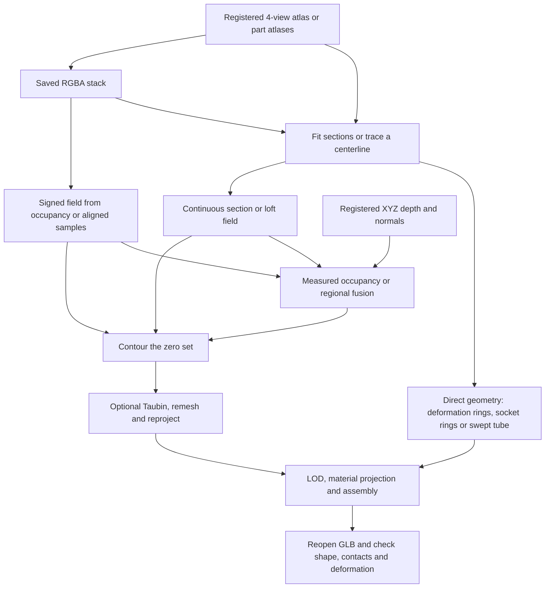

# Organic surfaces

Choose the reconstruction from the evidence available for each feature. A rounded body can use one stack; an overlapping wing may need its own views; a visible nostril outline supplies the mouth of a recess while its depth still needs a measurement or an estimate. Keep the whole atlas as the common scale, pose and mount reference when splitting parts. See [part atlas registration](part-atlases.md).



## Run the shared CLI path

Check `stack3 capabilities --json` for the `organic` mesh method and its guide fields. In a stack3.js checkout, invoke `node apps/cli/bin/stack3.mjs` from the repository root in place of `stack3` when the installed binary lacks the method.

For a saved stack, run `stack3 mesh body-stack --mesh-method organic --guide surface.guide.json --output body.glb`. A useful first comparison is a single extractor with filtering disabled, followed by the same extractor with a modest Gaussian radius. This guide selects the filtered arm:

```json
{"extractor":"hermite-dc","sigma":0.8,"interpolation":"cubic","smoothingIterations":0}
```

For YAML, use `reconstruct-stack` or `load-stack` → `extract-mesh` with **method `organic`** and the guide path → `write-glb`. Set `finish.triangleBudget` on the extraction node for QEM, `cache` on that node when reusing its output, and `lit: true` on the export for lighting review. Guide file references are relative to the guide. Node paths are relative to the root recipe. Run the existing starter from the checkout root:

```sh
node apps/cli/bin/stack3.mjs pipeline render examples/organic-surface/surface.pipeline.yaml
node apps/cli/bin/stack3.mjs pipeline run examples/organic-surface/surface.pipeline.yaml
```

| Decision | Control and check |
| --- | --- |
| Smooth the volume | Gaussian `sigma` is in units of the **smallest voxel pitch**. For a layer-count test, hold scene size and physical radius fixed: `sigma = radius / min(pitchXYZ)`. Give the filter exterior samples while preserving registration if the zero set reaches the grid boundary. Check feet, tips and gaps for shrinkage. |
| Compare extractors | Branch from the **same stack and scalar field**. Set `guide.extractor` to `hermite-dc`, `regularized-dc`, `marching-cubes` or `surface-nets`. Start with identical interpolation, zero Taubin iterations and no LOD cap. `linear` and `cubic` control sub-voxel crossings. |
| Improve triangle distribution | Set `smoothingIterations` for Taubin, `targetEdgeLength` in scene units for remeshing, and `adaptive: false` with that length for uniform remeshing. `reproject: true` moves vertices toward the field after postprocessing, before LOD. The Python backend uses PyMeshLab for mesh smoothing/remeshing; the QEM finish uses Blender. |
| Supply a fitted field | `guide.field` accepts a finite XYZ float `.npy` with one padded sample per side, negative inside, nonzero at sample centers, and signs matching the registered stack. When an authored loft changes occupancy, save its matching grid and alpha. Use `sigma: 0` to contour an already smoothed field directly. |

## Choose the shape treatment

These are reconstruction choices. The chick and pig fitting, assembly and rigging scripts under `examples/organic-surface/benchmarks/` implement the asset-specific operations in the table.

| Feature or symptom | Approach | Inspect |
| --- | --- | --- |
| Stair steps on a rounded body | Inspect horizontal cuts of the saved stack. The existing `round` profile clips each occupied layer to an ellipse; widths can still jump between layers. For a single outer loop, fit a periodic contour around the torso and a cubic B-spline through heights. Retain the original field where feet separate or topology changes. | Compare raw voxels, pre-QEM mesh and budgeted mesh at the same angle. A beak can inflate a whole band when one extreme width defines the entire ring. Check TOP and diagonal views. |
| Small or overlapping appendage | Use a local part grid when the whole stack has already lost the gap. Generate independent views of the detached part, fit its mount against the whole views, and mirror shared geometry when appropriate. | Trace the feature from atlas mask to stack to mesh. Compare whole and split assets at the same **total** triangle budget. |
| Continuous torso and legs | Use the limb profiles as inputs. Smooth-union their fields at shoulders and thighs before contouring a single closed body. Taper the blend above the hooves; a height-registered texture can carry the hoof color on the shared surface. | Check one connected body, four distinct lower cross sections and four grounded soles after simplification. |
| Soft blind opening | Fit the two aperture axes from FRONT. Sample rings from the outer pad through a rounded lip and inner wall to a closed floor. Author a lower-density set of rings for the game LOD. Record inferred depth. | Measure mouth width, center-to-pad depth and slope changes on the exported LOD under fixed lighting. |
| Folding ear or curled tail | Build the ear open with thickness and crosswise rings around the bend zone. Bind the root and distribute rotation over a short bone chain. For a tail, sweep a tapered tube along the observed centerline and record the inferred out-of-plane separation. | Scrub the fold for self-intersection, detached roots and tip penetration. Orbit the tail and check daylight through the curl from its broad side. |

## Use depth when there is a source for it

Capture a closed GLB already aligned to the stack with `stack3 capture-dexel body-stack --source aligned.glb --output measured.npz`. This records ordered enter/exit depths and outward normals along all three axes. Record whether the source is independently measured, artist-authored, or inferred from the same atlas. Recapturing an atlas-derived mesh tests the pipeline; hidden detail requires additional evidence.

* **Stack occupancy.** `{"dexel":"measured.npz"}` checks that the measured intervals agree with the saved alpha at grid centers.
* **Measured occupancy.** Add `"dexelOccupancy":"measured"` to reconstruct from the interval pairs, including multiple solid segments on one ray. Use `"sigma":0` to retain resolved measured crossings. Read the diagnostics for disagreement between axes and sub-voxel crossings.
* **Regional fusion.** Supply `depthRegions` as a list of ellipsoids with `center` and positive `radii` in registered stack XYZ scene units. Combine measured occupancy with an optional aligned prior `field`. The inner 70% of each radius uses full measured support and the outer band blends back into the prior. Set regions for the current part and pivot.

## Existing examples and verification

The paths below are relative to a **stack3.js checkout**. The benchmark directories contain their own inputs, recipes, render comparisons and measurement definitions.

| Question | Open under `examples/organic-surface/` |
| --- | --- |
| How do the common stages fit together? | `surface.pipeline.yaml` and `surface.guide.json` |
| Is the error from layers, the field, the extractor or QEM? | `benchmarks/chick/layer-count/README.md`, `benchmarks/chick/section-study/README.md` |
| Do new depths recover local relief? | `benchmarks/chick/section-study/depth/README.md` and `fused.yaml` in that directory |
| How do detached parts, textured eyes and skinning fit together? | `benchmarks/chick/parts/README.md`, its `textured/README.md` and `animation/README.md` |
| How do ears fold, legs join and nostrils retain soft rims? | `benchmarks/pig/README.md` and `benchmarks/pig/surface-revision/README.md` |

For geometry comparisons, use a common clay material, camera and object scale. Inspect texture projection separately if the clay contour is sound. Reimport the final GLB and check the actual triangle count, local silhouettes, surface connectivity, contact heights and animated poses relevant to the asset. Report agreement with generated input masks as atlas consistency. The chick's 64 layers and the pig's 1,600-triangle LOD are measured example settings; choose the next asset's grid and budget by the smallest feature it needs to retain.
